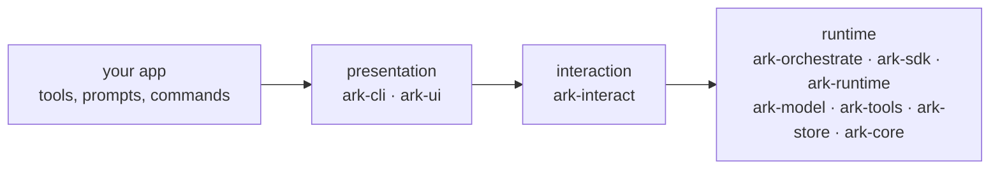

# ARK, the Agent Runtime Kit

A Rust runtime, SDK, terminal shell and workspace UI for building agents in any domain. ARK
provides the agent loop, context and token management, model routing, the tool and approval
model, working-state memory, persistence, usage accounting and a benchmark harness. An
application supplies its tools, prompts and vocabulary.

ARK came out of a security research workstation (SecRes, now retired) and keeps no trace of that domain.
The same runtime runs [`examples/writing-agent`](examples/writing-agent), an editor for
novelists, with no change to any ARK crate.

Latest release: **v0.18.0**. A git tag is the release (not on crates.io). Rust 1.90 or newer.
State and next steps: [`ROADMAP.md`](ROADMAP.md).

## How it is structured



The runtime is headless. The interaction layer turns its events into commands, reports and
activity without drawing anything. The terminal and the window both render that layer, so
they behave the same. Layers, crates and one turn step by step:
[`docs/ARCHITECTURE.md`](docs/ARCHITECTURE.md).

| Crate | Responsibility |
|---|---|
| `ark-core` | Pure types: artifacts, actions, invocations, capabilities, evidence cards, working state, focus, rule sets. No tool or domain name. |
| `ark-model` | One `Provider` trait: Anthropic, OpenAI and compatible endpoints, Ollama, Claude and ChatGPT subscriptions through their CLIs, a scriptable mock. Timeouts, retries, prompt caching, per-account capacity, managed vendor sessions. |
| `ark-store` | Content-addressed blobs, SQLite metadata, full-text search. |
| `ark-tools` | The `Adapter` / `Registry` tool boundary, a subprocess helper, an MCP bridge, and two generic adapters (diagram; web, off unless the app turns it on). Ships no domain tools. |
| `ark-runtime` | The agent loop: context budget, model router, distillation, tool disclosure, reuse, parallel reads, stall guard, retries, sessions, approvals, cancel, steering, metrics. |
| `ark-sdk` | The facade: `Ark::builder()`, `AgentProfile`, `prelude`. |
| `ark-orchestrate` | Several agents: agents, tasks, delegation, messages, a capacity-aware scheduler, one managed model session per agent, and an observable graph. |
| `ark-interact` | Between runtime and front-ends: `App`, `Interaction`, commands that return `Report`s, activity, traces, context and usage views. Draws nothing. |
| `ark-cli` | The terminal shell every ARK app opens into, plus headless `-p`. |
| `ark-ui` | The same app in a window (Tauri) or a local browser page. |
| `ark-bench` | Benchmark and eval harness for any ARK app. |

## Quick start

Pin a release tag:

```toml
[dependencies]
ark-sdk = { git = "https://github.com/0x00vb/ARK", tag = "v0.18.0" }
ark-model = { git = "https://github.com/0x00vb/ARK", tag = "v0.18.0" }
# several agents (also re-exported as `ark_interact::ark_orchestrate`)
ark-orchestrate = { git = "https://github.com/0x00vb/ARK", tag = "v0.18.0" }
# optional front-ends, same tag
ark-interact = { git = "https://github.com/0x00vb/ARK", tag = "v0.18.0" }
ark-cli = { git = "https://github.com/0x00vb/ARK", tag = "v0.18.0" }
```

A tool and an agent:

```rust
use ark_sdk::prelude::*;
use std::sync::Arc;

struct Weather;

#[async_trait::async_trait]
impl Adapter for Weather {
    fn name(&self) -> &str { "weather" }
    fn actions(&self) -> Vec<ActionDescriptor> {
        vec![ActionDescriptor::new("weather.today", "get today's forecast", RiskTier::Observe)
            .with_input_schema(serde_json::json!({
                "type": "object", "required": ["city"],
                "properties": { "city": { "type": "string" } }
            }))]
    }
    async fn run(&self, _a: &str, input: serde_json::Value, _c: &RunCtx<'_>) -> ark_tools::Result<ActionOutput> {
        let city = input.get("city").and_then(|v| v.as_str()).unwrap_or("");
        Ok(ActionOutput::json(serde_json::json!({ "city": city, "high_c": 24, "sky": "clear" })))
    }
}

async fn run() -> Result<(), ArkError> {
    let ark = Ark::builder()
        .store_root("./workspace")
        .tool(Arc::new(Weather))
        .profile(AgentProfile::builder()
            .instructions("You are a concise travel assistant. Use tools; never guess a forecast.")
            .build())
        .provider(ark_model::from_env_arc()?) // ARK_PROVIDER, ARK_MODEL
        .build()?;
    let project = ark.create_project("trip", "weekend planning")?;
    let outcome = ark.ask(&project.id, "what's the weather in Lisbon today?").await?;
    println!("{}", outcome.answer);
    Ok(())
}
```

The same agent as an interactive app (terminal; `ark_ui::ArkUi` opens it in a window):

```rust
let app = ark_interact::App::new("Weather").ark(ark);
ark_cli::ArkCli::new(app).run().await
```

Run the examples in this repository:

```sh
ARK_PROVIDER=ollama ARK_MODEL=qwen3:4b-instruct cargo run -p minimal-agent -- "what is 6 * 7?"
ARK_PROVIDER=ollama ARK_MODEL=qwen3:4b-instruct cargo run -p writing-agent   # interactive
cargo run -p agent-team   # a coordinator and two readers on Claude and ChatGPT subscriptions
cargo test --workspace   # no model needed: a scripted mock drives the loops
```

`ARK_PROVIDER` is `ollama` (default), `anthropic`, `openai`, `claude`, `codex`, `mock`, or a named
OpenAI-compatible endpoint (`ARK_ENDPOINTS`). Keys and every other
setting: [`docs/OPERATIONS.md`](docs/OPERATIONS.md).

## Builder defaults

| Builder method | Default | Purpose |
|---|---|---|
| `.store_root(path)` | `./ark-workspace` | store location; also connects the MCP plugins of `<root>/plugins.json` |
| `.tool(adapter)` / `.registry(r)` | empty | the application's tools |
| `.profile(AgentProfile)` | generic assistant | persona, capabilities, distillers, knowledge, core actions |
| `.provider(p)` / `.router(r)` | from the environment | one model, or a fast and a strong tier |
| `.context_budget(tokens)` | by model | request budget; unset, a quarter of the model's window, 6,000 to 48,000 (ADR 0050) |
| `.max_steps(n)` | 16 | step limit per turn |
| `.planner(bool)` / `.critic(bool)` | off / on | planning pass (off: ADR 0008) and critic pass |
| `.allow_mutate(bool)` | off | run state-changing actions without approval |
| `.web(bool)` / `.web_with(adapter)` | off | `web.search` and `web.fetch` |
| `.skills(names)` | every skill | the skills a conversation turn may read |

## Documentation

In reading order:

| Question | Doc |
|---|---|
| Where is ARK now, what is next? | [`ROADMAP.md`](ROADMAP.md) |
| How is it structured? How does a turn work? | [`docs/ARCHITECTURE.md`](docs/ARCHITECTURE.md) |
| How do I build an app? | [`docs/EXTENSION.md`](docs/EXTENSION.md), then [`docs/CLI.md`](docs/CLI.md) (terminal) and [`docs/UI.md`](docs/UI.md) (window) |
| How do several agents work together? | [`docs/ORCHESTRATION.md`](docs/ORCHESTRATION.md) |
| How do I run it in production? | [`docs/OPERATIONS.md`](docs/OPERATIONS.md): settings, failures, logs, long sessions |
| How do I develop and test ARK? | [`AGENTS.md`](AGENTS.md) (rules, lifecycle), [`CONTRIBUTING.md`](CONTRIBUTING.md) (commands) |
| How do I measure a change? | [`docs/BENCH.md`](docs/BENCH.md); results in [`bench/RESULTS.md`](bench/RESULTS.md) |
| How do I release ARK or upgrade an app? | [`docs/RELEASING.md`](docs/RELEASING.md) |
| What changed in a version? | [`CHANGELOG.md`](CHANGELOG.md) |

## License

MIT OR Apache-2.0.
