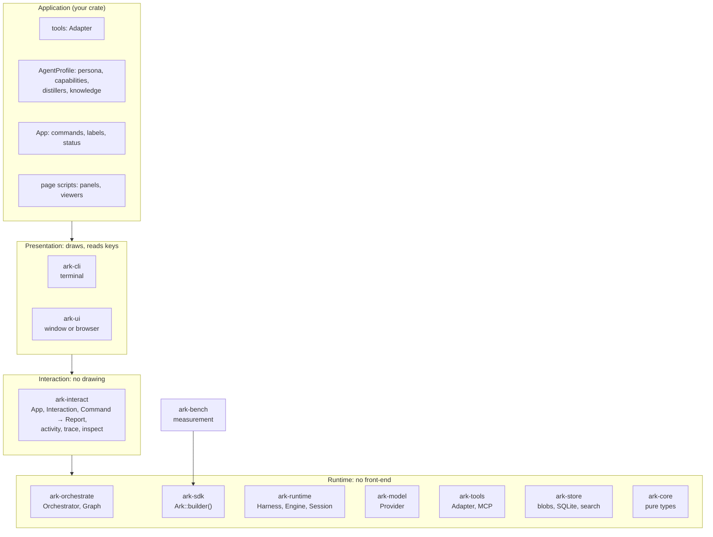
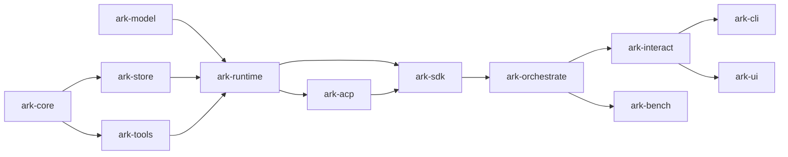
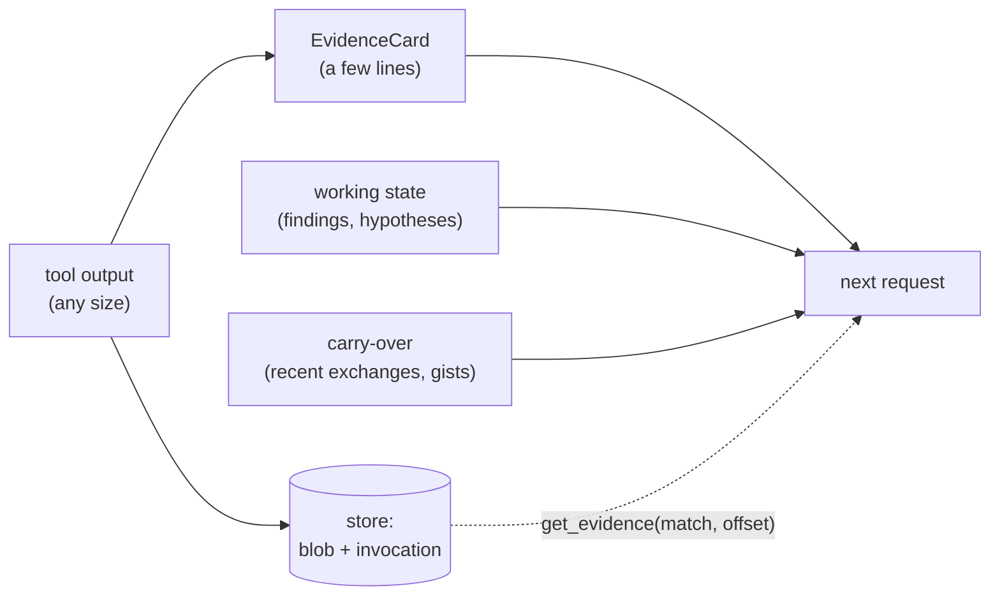
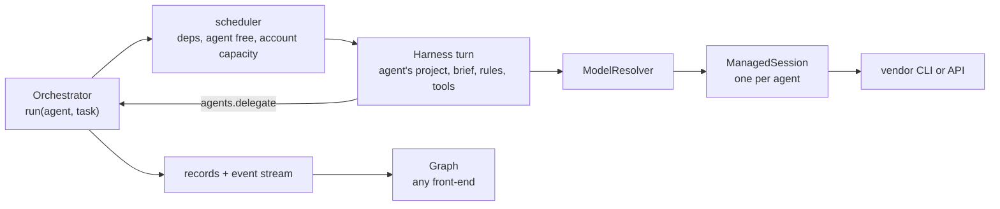

# Architecture

ARK is a stack of Rust crates. Each layer depends only on layers below it. No ARK crate
depends on an application. The application brings the domain; ARK brings the machinery.

## Layers



| Layer | Crates | Owns | Never knows about |
|---|---|---|---|
| Runtime | `ark-core` to `ark-orchestrate` | the loop, context, models, tools, memory, approvals, cancel, steering, several agents | terminals, windows, HTML |
| Interaction | `ark-interact` | sessions, turns, commands and `Report`s, activity words, traces, context and usage views | how anything is drawn |
| Presentation | `ark-cli`, `ark-ui` | drawing, keys, layout, transport | each other |
| Application | your crate | tools, prompts, vocabulary, commands, look | ARK internals |

Both front-ends call the same `Interaction` methods and render the same values. That is how
the terminal and the window stay in step: a command, a label or a trace view is written once.

## Crates



Arrows point from a dependency to its user. There are no cycles.

| Crate | Main types |
|---|---|
| `ark-core` | `Artifact`, `ArtifactKind` (+ `Other(String)`), `ActionDescriptor`, `RiskTier`, `Reuse`, `Invocation`, `Capability`, `CapabilityCatalog`, `EvidenceCard`, `ResearchState`, `WorkspaceContext`, `Focus`, `RuleSet`, `RuleBinding`. No tool or domain name. |
| `ark-model` | `Provider`, `Completion`, `Usage`, `ProviderError`, `RetryPolicy`, `MockProvider`; Anthropic, OpenAI, Ollama, `CliModel` (Claude Code, Codex), `catalog`; `Capacity`, `Limiter`; `SubscriptionRuntime`, `ManagedSession` |
| `ark-store` | `Store`: content-addressed blobs (blake3), SQLite metadata (WAL), Tantivy full-text index |
| `ark-tools` | `Adapter`, `Registry` (ships empty), `ToolSource`, `RunCtx`, `ActionOutput`, `subprocess`, `McpAdapter`; the generic `diagram` adapter (`Diagram`) and `web` adapter (search and fetch, off unless the app turns it on) |
| `ark-files` | the Files capability: `Files` tools (`files.list`, `read`, `search`, `write`, `edit`), `Format` (`xlsx`, `csv`, `docx`, text) edited in place, the shapes `Content::{Text, Sheet, Document}`, one `Edit` list for the agent and the window, a formula evaluator. Details: [ADR 0019](adr/0019-files-are-shared-in-place.md) |
| `ark-browser` | the Browser capability: `BrowserService` (a headless browser with a context per agent, a signed-in one on a lease), `Browser` tools, the DevTools client (`cdp`). Details: [ADR 0015](adr/0015-a-native-browser-shared-safely.md) |
| `ark-computer` | the Computer capability: `ComputerService` (one screen, one agent at a time, the person first), `Computer` tools that read a window as text and numbered controls, a `Screen` per platform (macOS accessibility; a fake for tests). Details: [ADR 0018](adr/0018-the-computer-one-screen-every-action-asked.md) |
| `ark-proc` | project processes: `Processes` (start in the person's shell, output kept and sent to windows, ready by address, stop by process group, the sweep after a crash), the `process` tool, `Installs` (programs installed through `acquire_capability`). Details: [ADR 0041](adr/0041-project-processes-asked-seen-and-stopped.md) |
| `ark-connect` | capabilities that need an account: `Catalog` (providers and capabilities, as data), `Connections` (accounts, a `ToolSource`), OAuth with PKCE, `Secrets` (OS keychain), the Mail and Calendar services. The only crate that names a third-party service. Details: [`GOOGLE.md`](GOOGLE.md) |
| `ark-account` | optional: the person's ARK Account on this computer (sign-in through the browser, staying signed in, `can` for ARK Cloud features), on `ark-connect`'s OAuth and `Secrets`. No runtime crate depends on it (ADR 0026) |
| `ark-runtime` | `Harness` (the loop), `Engine` (ingest, run actions, approval gate), `Session`, `AgentProfile`, `ModelRouter`, `DistillerSet`, `ApprovalGate`, `CancelToken`, `Steering`, `ContextReport`, `Metrics`; `Agent`, a plain ReAct loop; `worker::Worker` (a task done by another agent program, reported as the harness reports), `folder::Before` (what work changed in a folder) |
| `ark-acp` | agents on other agent programs over the Agent Client Protocol: `Catalog` (Claude Code, Codex, as data), `Acp` (a `Worker`: a clean environment, the asking mode, questions through ARK's gate, the program's own session after a restart). Details: [ADR 0043](adr/0043-attention-workers-and-where-work-runs.md) › Step 2 results |
| `ark-sdk` | `Ark`, `Ark::builder()`, `TurnOptions`, `prelude` |
| `ark-orchestrate` | `Orchestrator`, `AgentSpec`, `TaskSpec`, `TaskRecord`, `Budget`, `Models`, `ModelResolver`, `Graph`, `OrchEvent`. Details: [`ORCHESTRATION.md`](ORCHESTRATION.md) |
| `ark-interact` | `App`, `Interaction`, `Command`, `Reply`, `Report`, `ActivityLabels`, `ToolLabeler`, `trace`, `inspect`, `logging`; `remote::Client`, the protocol client of a runtime served elsewhere |
| `ark-cli` | `ArkCli`, `ArkArgs`, `Theme`; the same shell on this process's `Interaction` or on a runtime elsewhere (`--connect`, ADR 0024). Details: [`CLI.md`](CLI.md) |
| `ark-ui` | `ArkUi`, `Host`; Tauri window (feature `desktop`) or loopback HTTP + SSE. Details: [`UI.md`](UI.md) |
| `ark-bench` | `Workload`, metered provider, simulated model, reports, `compare`. Details: [`BENCH.md`](BENCH.md) |

## One turn

What happens between a person pressing enter and the answer, in either front-end.

```mermaid
sequenceDiagram
    participant FE as ark-cli / ark-ui
    participant IX as Interaction
    participant S as Session
    participant H as Harness
    participant M as Provider
    participant E as Engine + tools
    FE->>IX: run_turn(input, TurnControl)
    IX->>S: begin_turn (stored before any work)
    IX->>H: ask(input), bounded carry-over, never the transcript
    H->>H: load working state, classify; plan only if the planner is on (off by default) and the task is not trivial
    loop each step, up to max_steps
        H->>H: build request under the token budget
        H->>M: complete(system, messages, loaded tools)
        M-->>H: text and tool calls
        alt no tool calls
            H->>H: this is the answer
        else tool calls
            H->>H: runtime tools (load_action, get_evidence, ...) handled here
            H->>FE: Mutate call waits for approval (ApprovalGate, ChannelApprover)
            H->>E: run_action, reads in parallel, identical calls reused
            E-->>H: output, stored as an Invocation
            H->>H: distill output into a short EvidenceCard
        end
        H->>H: stall guard: no new information for 5 steps ends the loop
    end
    H->>H: self-check, critic if it fails, save working state
    H-->>IX: HarnessOutcome (answer, citations, metrics)
    IX->>S: record_turn
    IX-->>FE: TurnEnd
```

Every step emits typed `HarnessEvent`s (step, context report, text delta, model call, tool
call and result, retry, stall, approval, answer). `ark-interact` turns them into
`Activity` lines and a stored trace. The front-ends only draw them.

## Where the context goes

The model never gets raw tool output or the chat transcript.



| Mechanism | Module |
|---|---|
| Request assembled under a token budget from whole rounds; old rounds drop in chunks | `ark-runtime::budget` |
| Tool output distilled to an evidence card; full rows read on demand | `distill`, `evidence` |
| A compact action index; a schema is loaded only when needed | `catalog`, `capmap` |
| Fixed system prompt, tools in load order, working state last, so a prefix cache can serve it | `harness`, `ark-model` |
| Identical successful calls reused within the rules of `Reuse` | `harness` |
| Working state plus a bounded carry-over instead of transcript replay | `session` |
| Every request reports where its tokens came from | `context_report` |

Measured effect: [`bench/RESULTS.md`](../bench/RESULTS.md).

## Several agents

`ark-orchestrate` composes the single-agent loop; it does not change it. Each agent is one
harness turn per task, in its own child project, on its own models. Details:
[`ORCHESTRATION.md`](ORCHESTRATION.md).



## Design rules

| Rule | In practice |
|---|---|
| No domain in the core | `ark-core` names no tool, format or domain concept. `crates/ark-ui/tests/neutral.rs` checks the runtime and front-ends. |
| Inject, do not fork | Domain behavior goes through a seam: `Adapter`, `AgentProfile`, `Distiller`, `Sniffer`, `KnowledgeProvider`, `AcquisitionProvider`, `CapabilityCatalog`, `Provider`. |
| Headless runtime | The runtime emits events and takes an `ApprovalGate`, a `CancelToken` and `Steering`. It never sees a key or a colour. |
| One interaction layer | Commands, labels, views and traces live in `ark-interact`, so CLI and GUI mean the same thing. |
| Bounded context | Working state is the memory, not the transcript. `crates/ark-sdk/tests/long_session.rs` checks that request size stays flat. |
| Deterministic first | Distillers, the stall guard, reuse and the request layout are code, not model calls. |
| Every call is recorded | A tool call becomes an `Invocation` with its input, output and command line. A delegation is a tool call too. |
| Vendor sessions are disposable | ARK's store is canonical; a vendor session is reused while healthy and rebuilt from ARK's own request when it is not. |
| No global state | Everything hangs off the `Ark` or `Engine` you build. |

## Origin

ARK was extracted from SecRes, a security research workstation (since retired). The
extraction turned fixed security vocabularies into open, application-supplied ones:

| In SecRes | In ARK |
|---|---|
| a fixed enum of nine security capabilities | `Capability(slug)` and a `CapabilityCatalog` the app supplies |
| Mach-O, ELF, plist artifact kinds | universal kinds, `Other(String)` and a `Sniffer` |
| typed RE and network evidence families | one generic `EvidenceCard`; families stay in the app |
| the security persona, distillers, knowledge base | `AgentProfile`, `DistillerSet`, `KnowledgeProvider` |
| `WB_*` environment variables | `ARK_*` |

The test that kept it neutral: the same runtime must power an editor for a novelist.
[`examples/writing-agent`](../examples/writing-agent) does, with no change to any ARK crate.
