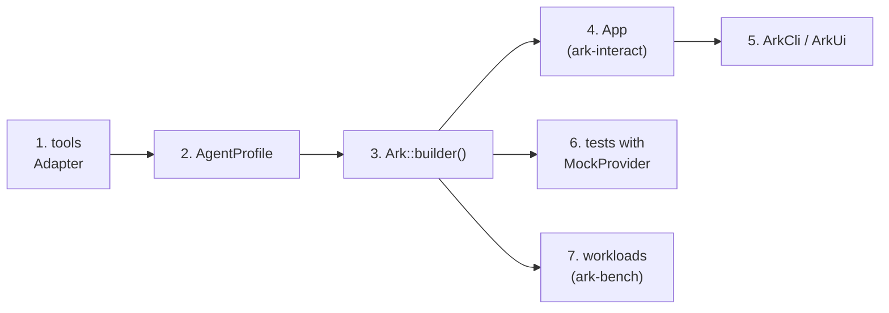

# Building an app on ARK

An ARK app is a crate that depends on ARK and supplies the domain. It never edits or forks
ARK. If an app needs behavior ARK cannot express, the missing seam is an ARK change (see
[`AGENTS.md`](../AGENTS.md)), not a workaround in the app.

## Steps



| Step | What you write | Smallest example |
|---|---|---|
| 1. Tools | one `Adapter` per namespace | `examples/minimal-agent/src/main.rs` |
| 2. Profile | persona, capabilities, distillers | same file, `build_ark` |
| 3. Agent | `Ark::builder()...build()`, then `ark.ask(..)` | README quick start |
| 4. App | commands, labels, status sections | `examples/writing-agent/src/main.rs` |
| 5. Front-end | `ArkCli::new(app).run()`, or `ArkUi::new(app)` | same file; [`CLI.md`](CLI.md), [`UI.md`](UI.md) |
| 6. Tests | scripted model, no network | `cargo test -p writing-agent` |
| 7. Benchmark | your own `Workload`s | SecRes `crates/secres-bench`; [`BENCH.md`](BENCH.md) |

Steps 4 to 7 are optional. A headless agent stops at step 3 and depends on `ark-sdk` and
`ark-model` only.

## 1. Tools: the `Adapter` trait

An `Adapter` is a namespace and a set of `ActionDescriptor`s, each with a JSON Schema input
and a `RiskTier`. `run(action, input, ctx)` returns an `ActionOutput`: a JSON summary, the
exact command line for reproducibility, and any produced artifacts.

```rust
#[async_trait::async_trait]
impl Adapter for MyTool {
    fn name(&self) -> &str { "mytool" }
    fn actions(&self) -> Vec<ActionDescriptor> {
        vec![ActionDescriptor::new("mytool.do", "do the thing", RiskTier::Read)
            .with_capabilities([Capability::new("my-capability")])
            .with_input_schema(serde_json::json!({ "type": "object", "properties": {} }))]
    }
    async fn run(&self, action: &str, input: serde_json::Value, ctx: &RunCtx<'_>)
        -> ark_tools::Result<ActionOutput> { /* ... */ }
}
```

| Choice | Rule |
|---|---|
| `RiskTier` | `Read` and `Observe` run without asking. `Mutate` asks a person first (or runs with `allow_mutate`). Anything that writes, spends money or touches a remote system is `Mutate`. |
| `Reuse` | see [Reuse of results](#reuse-of-results) |
| `ctx.workspace` | the project's directory on disk; keep file writes inside it |
| `ctx.blobs` | reads a stored artifact by id |
| large output | return it as a produced artifact; keep the JSON summary small |

## 2. The `AgentProfile`

The one struct that turns the generic runtime into your agent. Build it with
`AgentProfile::builder()`; every field has a neutral default.

| Field | What it injects |
|---|---|
| `prompts.instructions` | persona and method: the agent's identity |
| `prompts.plan_system`, `critic_intro`, `force_answer` | planner, critic and fallback prompts |
| `capabilities` | a `CapabilityCatalog` (slug, description, synonyms) |
| `inferrer` | maps action names to capabilities when a descriptor declares none |
| `distillers` | a `DistillerSet` of result summarizers (below) |
| `knowledge` | an optional `KnowledgeProvider`; adds the `search_knowledge` tool |
| `acquisition` | an optional `AcquisitionProvider`; adds `find/propose/acquire_capability` |
| `core_actions` | actions always loaded, so simple tasks skip discovery |
| `investigation_markers` | phrases that mark a task as an investigation rather than trivial |
| `approval_classifier` | groups approvals so "allow for this session" covers the right calls |

## 3. Distillers

A `Distiller` is `Fn(action, output) -> Option<(summary, identifiers)>`. It turns a tool's
output into the few lines the model sees, without a model call. Yours run first, then ARK's
common distiller (files, exec, edit, diff shapes), then a generic fallback.

```rust
let d: Distiller = std::sync::Arc::new(|action, out| match action {
    "mytool.do" => Some((format!("did {} things", out["count"]), vec![])),
    _ => None,
});
let distillers = DistillerSet::with_common().with(d);
```

## 4. Other seams

| Seam | Use it to |
|---|---|
| `ark_core::Sniffer`, `engine.register_sniffer(..)` | classify ingested bytes as `ArtifactKind::Other("...")` |
| `.agents/skills`, `<store_root>/skills` | give the agent instructions for kinds of work, read only when a task needs them. See [Skills](#skills) |
| `<store_root>/plugins.json` | add MCP servers in any language; each tool becomes `<name>.<tool>`, risk from MCP annotations or `x-ark-risk`. See [MCP plugins](#mcp-plugins) |
| `Provider` | add a model backend; `ModelRouter::new(fast, strong)` splits planning from reasoning |
| `KnowledgeProvider` | give the agent a reference corpus it cites apart from observations |
| `Command` (`ark-interact`) | add a slash command that returns a `Report`; both front-ends render it |
| `ActivityLabels`, `ToolLabeler` (`ark-interact`) | say how your tools read in activity lines and approvals |
| `ArkUi::handler`, `window.ark` | add backend methods, panels and viewers to the workspace ([`UI.md`](UI.md)) |

### MCP plugins

A plugin is a local MCP server (stdio). `<store_root>/plugins.json` lists them; the engine
connects each when it opens and keeps them in `Engine::plugins()`. They can be added, removed
and restarted while it runs.

```json
{ "plugins": [ { "name": "entropy", "command": "python3", "args": ["entropy_server.py"],
                 "env": { "KEY": "value" } } ] }
```

| Who | How |
|---|---|
| Terminal | `/plugin` lists them; `/plugin add <name> [KEY=VALUE…] <command> [args…]`, `/plugin remove <name>`, `/plugin restart <name>`. `add` also takes a pasted `{"mcpServers": {…}}` snippet |
| Window | Settings › Tool servers (when the app was opened on a store root) |
| Code | `Engine::add_plugin(PluginSpec)`, `engine.plugins()?.remove(name)`, `.restart(name)`, `.list()`; `ark_interact::plugins` words them for both front-ends |

| Rule | Why |
|---|---|
| A change applies from the next turn or task | A turn takes `Engine::tools()` (the app's registry plus the plugins connected then) when it starts, so its tool list never moves mid-turn |
| Agents still choose | An orchestrated agent gets a plugin's tools only when its `tools` patterns match (`entropy.*`) |
| Only the person adds one | It starts a process. No agent tool adds, removes or restarts a plugin |
| A server has 20 s to answer `initialize` and `tools/list` | A server that hangs is refused (and stopped), not waited on |
| A plugin's name is not one of the app's own adapters | `<name>.<tool>` must stay unambiguous |
| Local servers only | A `url` (remote) entry is refused |

### Skills

A skill is a folder with a `SKILL.md`: front matter with a `name` (lower case, digits, `-`) and a
`description` (when to use it), then the instructions, and any files they refer to. ARK reads
them from the project folder's `.agents/skills` (where `npx skills add` installs) and the
store's `skills` (every project); the project's wins on a name.

| Part | What |
|---|---|
| In each request | One line per skill the turn may read, after the rules, capped at `skills::CATALOG_BUDGET` tokens; reported as `skills` in `ContextReport` |
| On demand | `skills.read {name}` (the instructions and the files beside them), `skills.file {name, path}` (one file, inside the skill's folder) |
| Who reads which | The conversation: all (`ArkBuilder::skills` narrows it). An orchestrated agent: the ones `AgentSpec::skills` names, none by default |
| Front-ends | `/skills`; Settings › Skills in the window |
| Not ARK's | Installing skills, and running scripts a skill mentions (that needs a tool the app gives) |

Why the instructions are not sent up front: [ADR 0009](adr/0009-skills-load-on-demand.md).

### The web

`ArkBuilder::web(true)` offers `web.search` and `web.fetch` in every turn, preloaded, and to
each orchestrated agent whose `tools` patterns allow them (`web.*`, `web.search`). Both are
`Observe`: they run without asking.

| Action | What |
|---|---|
| `web.search {query, limit}` | Up to 10 results (title, link, a sentence). Sources in order, the first that finds something: the turn's own model's search (Claude API, Claude Code, Codex), Brave's result page, Wikipedia. No key |
| `web.fetch {url}` | The page as text (its `<main>` or `<article>` when marked), its title and up to 60 links. HTML and text only, at most 4 MB. Loopback and private addresses are refused, also after a redirect |
| Card | Search results whole; a page's first 1,500 characters, the rest through `get_evidence` with `path: "text"` and `match` |
| Own search API | `ArkBuilder::web_with(WebAdapter::new().search_with(backend))`, `backend` a `web::SearchBackend` |

Why no key, and what each source does: [ADR 0010](adr/0010-web-search-without-a-key.md).

### Capabilities and accounts

`ArkBuilder::connections(true)` lets people connect accounts, and the capabilities they give
join every turn (and agents whose `tools` allow them). The person sees capabilities, never
scopes or servers: `/connect` lists them (`✓` ready, `○` one sign-in away, `!` unavailable and
why), `/connect mail` opens the provider's sign-in in their browser, `/disconnect mail`
revokes and forgets the account. The window has the same list in Settings › Capabilities.

| Part | What |
|---|---|
| Catalog (`ark-connect/src/catalog.json`) | Providers (how to sign in) and capabilities (label, one line, tool namespaces, provider, scopes, service). An app can bring its own (`Connections::open`) |
| Account | One signed-in account; record in the store root's `connections.json`, refresh token in the OS keychain, access token in memory |
| Tools | Neutral names: `mail.send` (Mutate), `calendar.events` (Observe), `calendar.create` (Mutate). Another provider can back the same capability |
| Consent | Each capability asks for its own scopes, added to the provider's account |
| Without a client id | The capability shows as unavailable: "this build of ARK cannot sign in to Google yet" |

Why ARK owns the connection: [ADR 0011](adr/0011-capabilities-and-connections.md). Google's
side (client, review, privacy policy): [`GOOGLE.md`](GOOGLE.md).

## Reuse of results

An identical successful call may be served from an earlier result.

| Declare | When | Reused |
|---|---|---|
| nothing (`Reuse::Auto`) | most actions | within a turn until something changes state; across turns only a `Read` of a stored artifact |
| `.reusable()` (`Reuse::Stable`) | output depends only on input | always |
| `.volatile()` (`Reuse::Volatile`) | a live capture, a clock, a counter | never |

SecRes marks its live captures (`frida.trace`, `debug.trace`, `debug.memory`, `debug.attach`)
volatile.

## What the user is looking at

A front-end reports the focused view and selection as a `Focus`. A `Selection` has `text`,
`line` and any other marks in the view's own words: `{"address": "0x1000"}`,
`{"cell": "B4"}`. The agent sees each as `name value`. ARK gives none of these names a
meaning.

## Do not

- Add a domain type to `ark-core`. Use `Other(String)`, a capability slug or a distiller.
- Fork the runtime to change behavior. Ask for the seam instead.
- Replay the transcript into a prompt. The working state is the memory.
