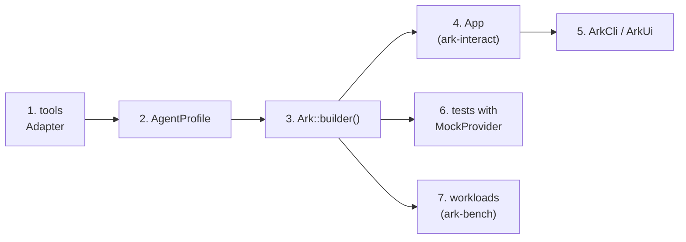

# Building an app on ARK

An ARK app is a crate that depends on ARK and supplies the domain. It never edits or forks
ARK. If an app needs behavior ARK cannot express, the missing seam is an ARK change (see
[`AGENTS.md`](../AGENTS.md)), not a workaround in the app.

## Steps



| Step | What you write | Smallest example |
|---|---|---|
| 1. Tools | one `Adapter` per namespace | `examples/minimal-agent/src/main.rs` |
| 2. Profile | persona, capabilities, distillers | same file, `build_ark` |
| 3. Agent | `Ark::builder()...build()`, then `ark.ask(..)` | README quick start |
| 4. App | commands, labels, status sections | `examples/writing-agent/src/main.rs` |
| 5. Front-end | `ArkCli::new(app).run()`, or `ArkUi::new(app)` | same file; [`CLI.md`](CLI.md), [`UI.md`](UI.md) |
| 6. Tests | scripted model, no network | `cargo test -p writing-agent` |
| 7. Benchmark | your own `Workload`s | [`BENCH.md`](BENCH.md) |

Steps 4 to 7 are optional. A headless agent stops at step 3 and depends on `ark-sdk` and
`ark-model` only.

## 1. Tools: the `Adapter` trait

An `Adapter` is a namespace and a set of `ActionDescriptor`s, each with a JSON Schema input
and a `RiskTier`. `run(action, input, ctx)` returns an `ActionOutput`: a JSON summary, the
exact command line for reproducibility, and any produced artifacts.

```rust
#[async_trait::async_trait]
impl Adapter for MyTool {
    fn name(&self) -> &str { "mytool" }
    fn actions(&self) -> Vec<ActionDescriptor> {
        vec![ActionDescriptor::new("mytool.do", "do the thing", RiskTier::Read)
            .with_capabilities([Capability::new("my-capability")])
            .with_input_schema(serde_json::json!({ "type": "object", "properties": {} }))]
    }
    async fn run(&self, action: &str, input: serde_json::Value, ctx: &RunCtx<'_>)
        -> ark_tools::Result<ActionOutput> { /* ... */ }
}
```

| Choice | Rule |
|---|---|
| `RiskTier` | `Read` and `Observe` run without asking. `Mutate` asks a person first (or runs with `allow_mutate`). Anything that writes, spends money or touches a remote system is `Mutate`. |
| `Reuse` | see [Reuse of results](#reuse-of-results) |
| `ctx.workspace` | the project's directory on disk; keep file writes inside it |
| `ctx.blobs` | reads a stored artifact by id |
| large output | return it as a produced artifact; keep the JSON summary small |

## 2. The `AgentProfile`

The one struct that turns the generic runtime into your agent. Build it with
`AgentProfile::builder()`; every field has a neutral default.

| Field | What it injects |
|---|---|
| `prompts.instructions` | persona and method: the agent's identity |
| `prompts.plan_system`, `critic_intro`, `force_answer` | planner, critic and fallback prompts |
| `capabilities` | a `CapabilityCatalog` (slug, description, synonyms) |
| `inferrer` | maps action names to capabilities when a descriptor declares none |
| `distillers` | a `DistillerSet` of result summarizers (below) |
| `knowledge` | an optional `KnowledgeProvider`; adds the `search_knowledge` tool |
| `acquisition` | an optional `AcquisitionProvider`; adds `find/propose/acquire_capability` |
| `core_actions` | actions always loaded, so simple tasks skip discovery |
| `investigation_markers` | phrases that mark a task as an investigation rather than trivial |
| `approval_classifier` | groups approvals so "allow for this session" covers the right calls |

## 3. Distillers

A `Distiller` is `Fn(action, output) -> Option<(summary, identifiers)>`. It turns a tool's
output into the few lines the model sees, without a model call. Yours run first, then ARK's
common distiller (files, exec, edit, diff shapes), then a generic fallback.

```rust
let d: Distiller = std::sync::Arc::new(|action, out| match action {
    "mytool.do" => Some((format!("did {} things", out["count"]), vec![])),
    _ => None,
});
let distillers = DistillerSet::with_common().with(d);
```

## 4. Other seams

| Seam | Use it to |
|---|---|
| `ark_core::Sniffer`, `engine.register_sniffer(..)` | classify ingested bytes as `ArtifactKind::Other("...")` |
| `.agents/skills`, `<store_root>/skills` | give the agent instructions for kinds of work, read only when a task needs them. See [Skills](#skills) |
| `<store_root>/plugins.json` | add MCP servers in any language; each tool becomes `<name>.<tool>`, risk from MCP annotations or `x-ark-risk`. See [MCP plugins](#mcp-plugins) |
| `Provider` | add a model backend; `ModelRouter::new(fast, strong)` splits planning from reasoning |
| `KnowledgeProvider` | give the agent a reference corpus it cites apart from observations |
| `Command` (`ark-interact`) | add a slash command that returns a `Report`; both front-ends render it |
| `ActivityLabels`, `ToolLabeler` (`ark-interact`) | say how your tools read in activity lines and approvals |
| `ArkUi::handler`, `window.ark` | add backend methods, panels and viewers to the workspace ([`UI.md`](UI.md)) |

### MCP plugins

A plugin is a local MCP server (stdio). `<store_root>/plugins.json` lists them; the engine
connects each when it opens and keeps them in `Engine::plugins()`. They can be added, removed
and restarted while it runs.

```json
{ "plugins": [ { "name": "entropy", "command": "python3", "args": ["entropy_server.py"],
                 "env": { "KEY": "value" } } ] }
```

| Who | How |
|---|---|
| Terminal | `/plugin` lists them; `/plugin add <name> [KEY=VALUE…] <command> [args…]`, `/plugin remove <name>`, `/plugin restart <name>`. `add` also takes a pasted `{"mcpServers": {…}}` snippet |
| Window | Settings › Tool servers (when the app was opened on a store root) |
| Code | `Engine::add_plugin(PluginSpec)`, `engine.plugins()?.remove(name)`, `.restart(name)`, `.list()`; `ark_interact::plugins` words them for both front-ends |

| Rule | Why |
|---|---|
| A change applies from the next turn or task | A turn takes `Engine::tools()` (the app's registry plus the plugins connected then) when it starts, so its tool list never moves mid-turn |
| Agents still choose | An orchestrated agent gets a plugin's tools only when its `tools` patterns match (`entropy.*`) |
| Only the person adds one | It starts a process. No agent tool adds, removes or restarts a plugin |
| A server has 20 s to answer `initialize` and `tools/list` | A server that hangs is refused (and stopped), not waited on |
| A plugin's name is not one of the app's own adapters | `<name>.<tool>` must stay unambiguous |
| Local servers only | A `url` (remote) entry is refused |

### Skills

A skill is a folder with a `SKILL.md`: front matter with a `name` (lower case, digits, `-`) and a
`description` (when to use it), then the instructions, and any files they refer to. ARK reads
them from the project folder's `.agents/skills` (where `npx skills add` installs) and the
store's `skills` (every project); the project's wins on a name.

| Part | What |
|---|---|
| In each request | One line per skill the turn may read, after the rules, capped at `skills::CATALOG_BUDGET` tokens; reported as `skills` in `ContextReport` |
| On demand | `skills.read {name}` (the instructions and the files beside them), `skills.file {name, path}` (one file, inside the skill's folder) |
| Who reads which | The conversation: all (`ArkBuilder::skills` narrows it). An orchestrated agent: the ones `AgentSpec::skills` names, none by default |
| Front-ends | `/skills`; Settings › Skills in the window |
| Not ARK's | Installing skills, and running scripts a skill mentions (that needs a tool the app gives) |

Why the instructions are not sent up front: [ADR 0009](adr/0009-skills-load-on-demand.md).

### The web

`ArkBuilder::web(true)` offers `web.search` and `web.fetch` in every turn, preloaded, and to
each orchestrated agent whose `tools` patterns allow them (`web.*`, `web.search`). Both are
`Observe`: they run without asking.

| Action | What |
|---|---|
| `web.search {query, limit}` | Up to 10 results (title, link, a sentence). Sources in order, the first that finds something: the turn's own model's search (Claude API, Claude Code, Codex), Brave's result page, Wikipedia. No key |
| `web.fetch {url}` | The page as text (its `<main>` or `<article>` when marked), its title and up to 60 links. HTML and text only, at most 4 MB. Loopback and private addresses are refused, also after a redirect |
| Card | Search results whole; a page's first 1,500 characters, the rest through `get_evidence` with `path: "text"` and `match` |
| Own search API | `ArkBuilder::web_with(WebAdapter::new().search_with(backend))`, `backend` a `web::SearchBackend` |

Why no key, and what each source does: [ADR 0010](adr/0010-web-search-without-a-key.md).

### Capabilities and accounts

`ArkBuilder::connections(true)` lets people connect accounts, and the capabilities they give
join every turn (and agents whose `tools` allow them). The person sees capabilities, never
scopes or servers: `/connect` lists them (`✓` ready, `○` one sign-in away, `!` unavailable and
why), `/connect mail` opens the provider's sign-in in their browser, `/disconnect mail`
revokes and forgets the account. The window has the same list in Settings › Capabilities.

| Part | What |
|---|---|
| Catalog (`ark-connect/src/catalog.json`) | Providers (how to sign in) and capabilities (label, one line, tool namespaces, provider, scopes, service). An app can bring its own (`Connections::open`) |
| Account | One signed-in account; record in the store root's `connections.json`, refresh token in the OS keychain, access token in memory |
| Tools | Neutral names: `mail.send` (Mutate), `calendar.events` (Observe), `calendar.create` (Mutate). Another provider can back the same capability |
| Consent | Each capability asks for its own scopes, added to the provider's account |
| Without a client id | The capability shows as unavailable: "this build of ARK cannot sign in to Google yet" |

An agent that needs a capability mid-task asks for it: the turn's first message lists what
can be added, the agent calls `acquire_capability {need}`, the person sees "ARK needs this to
finish: Connect Google so ARK can send email from your account" with Connect or Not now, and
after the sign-in the capability's tools join the same turn. Set `App::sign_in` when the
sign-in page cannot open in a browser on the machine ARK runs on. Why:
[ADR 0013](adr/0013-asking-for-a-capability-mid-task.md).

Why ARK owns the connection: [ADR 0011](adr/0011-capabilities-and-connections.md).

### An ARK Account

`ark-account` signs a person in to an ARK Account: who ARK Cloud serves. It is optional and
separate from the runtime. Nothing local asks for it; a Cloud feature asks `can`.

```rust
let account = Account::new(Service::ark("my-app"), Arc::new(ark_connect::Keychain));
account.set_computer_name("MacBook Pro");   // optional: names this sign-in on the account page
account.refresh().await.ok();               // at launch: check the saved sign-in
let s = account.sign_in().await?;           // open s.url() in the browser
let profile = s.finish(Duration::from_secs(900)).await?;
match account.can("cloud.agents") { Access::Allowed => {}, Access::SignIn => {}, Access::NotIncluded => {} }
let token = account.access_token().await?;  // for ARK Cloud's API; never log it
account.sign_out().await?;                  // revokes this computer's token
```

| Part | What |
|---|---|
| Service | `Service::ark(client_id)` is `https://account.aiark.dev`; `ARK_ACCOUNT_URL` points at another OpenID Connect provider that serves `/v1/me` |
| Kept | Refresh token and last profile in the OS keychain (`account:<issuer>`); access tokens in memory |
| Profile | `id` (the identity), `email`, `name`, `image`, `entitlements` |
| Client id | Each app has its own at the service (ARK Desktop: `ark-desktop`) |
| Computer name | `set_computer_name`: sent once per run to `PUT /v1/me/computer`, with the refresh token that says which sign-in it is. A service without names answers 404 and is not asked again ([ADR 0031](adr/0031-an-app-names-its-computers-sign-in.md)) |

Why: [ADR 0026](adr/0026-an-optional-ark-account.md).

### The browser

`ArkBuilder::browser(true)` gives agents the browser the person has (Chrome, Edge or Brave),
driven over the DevTools protocol ([ADR 0015](adr/0015-a-native-browser-shared-safely.md)).

| Action | What |
|---|---|
| `browser.open {url, signed_in}` | Open a page: its text and a numbered list of elements (links, buttons, fields). `signed_in: true` uses ARK's own signed-in profile |
| `browser.read`, `browser.back` | The current page again; the previous page |
| `browser.click {ref}`, `browser.type {ref, text, submit}` | Act on an element by its number. Mutate: they go through the approval gate |

Each agent (and the conversation) has its own fresh browser context, so agents browse at once
without sharing cookies. The signed-in browser is one at a time: an agent that wants it waits
until the one using it has been idle for a minute. Addresses on this machine and private
networks are refused, except the pages a running process of the agent's project serves itself,
in the fresh browser (ADR 0046). Profiles live in the store root's `browser` folder; `ARK_BROWSER_BIN`
picks another browser.

Tools each agent gets its own of (the web on its model, the browser) are `PerAgent` sources
(`ark_runtime::per_agent`); an app adds one the same way.

### The computer

`ArkBuilder::computer(true)` lets agents use the apps on this computer (macOS for now; not
offered elsewhere), read through the accessibility interface: a window is its text and a
numbered list of controls, as a page is in the browser ([ADR 0018](adr/0018-the-computer-one-screen-every-action-asked.md)). An Auto chat uses it without asking; a chat that asks asks once, and the answer lasts the chat ([ADR 0128](adr/0128-the-computer-asks-once-and-not-in-auto.md)).

It starts off. While off, a turn carries one line saying the agent can ask for it, and no
computer schema; an agent that needs an app calls `acquire_capability`, the person answers
"Allow ARK to use the apps on this computer" (Allow, Not now), and the tools join the running
turn. The answer is kept in the store's `computer.json`; Settings › Capabilities and
`/connect computer`, `/disconnect computer` turn it on and off
([ADR 0045](adr/0045-a-capability-the-person-turns-on-mid-task.md)). A source of per-agent tools
that is off until the person allows it does the same through `PerAgent::acquisition`.
`computer_with(svc)` gives a service that is on unless it was made with
`ComputerService::switched`.

| Action | What |
|---|---|
| `computer.apps` | The open apps. Runs on its own |
| `computer.look {app}` | The app's front window: text and numbered controls |
| `computer.open {app}`, `computer.click {app, ref, name}`, `computer.type {app, ref, name, text}`, `computer.keys {app, keys}` | Start or bring forward an app; press a control; type into a field without submitting; press a key or shortcut (`cmd+s`). The name must be the control's at that number. Each answers with the window after |
| `computer.draft`, `computer.send`, `computer.cancel` | Draft, verify, send or clear an exact message through a consumer's `MessageEvidence`. An uncertain submission is terminal and blocks Computer changes until the person checks the app (ADR 0056) |

Every action but `apps` asks each time (`ActionDescriptor::ask_each_time`): Allow once or Deny,
never remembered, so nothing on the screen runs unattended. Keys and text that go to the app in
front are sent only once the approved app is there.

One agent (or chat) holds the screen at a time; another waits until its turn or task ends or
it has been idle for 30 s. Every action waits until the person has left the keyboard and
mouse alone for 1.5 s. `ComputerService::take_back` (the window's Stop) ends the holder's use
for its turn or task. The first action asks macOS for the Accessibility permission and waits
for the person to allow it. `computer_with(ComputerService::with_screen(..))` puts another
`Screen` underneath; `ark_computer::fake::FakeScreen` is one for tests.

### Files

`ArkBuilder::files(true)` gives agents the project folder's files: text, spreadsheets
(`.xlsx`, `.xlsm`, `.csv`, `.tsv`) and documents (`.docx`), read and changed in place; PDFs and
images read only
([ADR 0019](adr/0019-files-are-shared-in-place.md)). The window opens the same files.

| Action | What |
|---|---|
| `files.list {path}`, `files.search {query, path}` | Files under a folder; lines, cells and blocks that contain a text. Run on their own |
| `files.read {path, sheet, range, from}` | Text with line numbers; a spreadsheet as rows with cell names and formulas; a document as numbered Markdown blocks. Bounded; the answer says what to read next. Carries the file's `version` |
| `files.write {path, text \| rows \| sheets}` | A whole new file, or a replacement. A document from Markdown, a spreadsheet from rows (`=` starts a formula). Asks |
| `files.edit {path, edits, version}` | Part of a file, the rest kept: `{cell, value}`, `{cell, rows}`, `{clear}`, `{add_sheet, rows}`, `{rename_sheet, to}`, `{delete_sheet}`; `{block, text}`, `{after, text}`, `{delete}`; `{find, replace}`. With `version`, refused if the file changed since. Asks |

A new format is a `Format` (`read`, `edit`, `create`) in `ark_files::FORMATS`. One that reads
into an existing shape (`Content::Sheet`, `Document`, `Text`) needs nothing else: the tools,
the edits and the window's views work on shapes. An app that keeps its own file tools can
still use `ark_files::open`, `edit` and `write` for the formats.

A file's kind (`ark_files::Kind`: text, Markdown, spreadsheet, document, PDF, image) is what
the person sees and the key of the window's view; a format has one. A PDF reads as its text and
shows as a PDF; an image reads as its type and size. `ark_files::Kinds` is a sniffer the SDK
registers, so a file any tool writes (`ProducedArtifact::at(path)`) is stored with the same kind
([ADR 0021](adr/0021-an-output-is-a-file-with-a-kind.md)).

### Run code

`ArkBuilder::code(true)` gives agents `code.run {code, runtime?, timeout?}`: a program run in the
project folder, contained ([ADR 0020](adr/0020-running-code-contained-in-the-project.md)).

| | |
|---|---|
| Where | The project folder is the working folder; each run has a scratch folder of its own, removed after |
| What it may touch | Reads the system folders, its environment and the project. Writes the project only, not `.git`, `.agents`, `.ark`, `.claude`, `.codex`, `.vscode`, `.idea`, `.envrc` or `.github` (one of these a run creates is removed after it). No network |
| Runtimes | Python 3.12 with pandas, numpy, matplotlib, openpyxl, xlsxwriter, python-calamine (fast `.xlsx`, `.xls`, `.xlsb`, `.ods` reads), duckdb (SQL over files and data frames, with its `excel` extension) and pyarrow, set up with `uv` in `<store>/exec/python` on the first run. Another is a `Runtime` (`ready` returns how to start a program) passed to `code_with(Exec::new(..))` |
| What comes back | The exit, the end of stdout and stderr, and every file the run wrote, each an artifact with its path; the window shows each by its kind |
| Asks | Every run, unless the person allows it in the project: the run is contained, so the grant covers only contained runs |
| Where it is offered | Where ARK has a `Sandbox` ([ADR 0032](adr/0032-run-code-contained-on-every-system.md)): macOS; Linux with `bwrap` and user namespaces; Windows when the program calls `ark_exec::entry()` first in `main` (a run starts through the program, in an AppContainer). Elsewhere it is not listed |

### Approvals that last

Every approval offers Allow once, Allow for this session, Always in this project, and Deny
(`ark_interact::approval_choices`). "Always" is a record in the store for the open project
(`ark_runtime::lasting_grants`, `remove_lasting_grant`); it covers every later call of that
approval class in the project, in any session, until the person removes it with `/grants` or
in Settings › Permissions. A connect question offers only Connect or Not now. Google's
side (client, review, privacy policy): [`GOOGLE.md`](GOOGLE.md).

## Reuse of results

An identical successful call may be served from an earlier result.

| Declare | When | Reused |
|---|---|---|
| nothing (`Reuse::Auto`) | most actions | within a turn until something changes state; across turns only a `Read` of a stored artifact |
| `.reusable()` (`Reuse::Stable`) | output depends only on input | always |
| `.volatile()` (`Reuse::Volatile`) | a live capture, a clock, a counter | never |

Mark live captures (a trace, a reading of a device, anything that changes between two calls)
volatile.

## What the user is looking at

A front-end reports the focused view and selection as a `Focus`. A `Selection` has `text`,
`line` and any other marks in the view's own words: `{"address": "0x1000"}`,
`{"cell": "B4"}`. The agent sees each as `name value`. ARK gives none of these names a
meaning.

## Do not

- Add a domain type to `ark-core`. Use `Other(String)`, a capability slug or a distiller.
- Fork the runtime to change behavior. Ask for the seam instead.
- Replay the transcript into a prompt. The working state is the memory.
