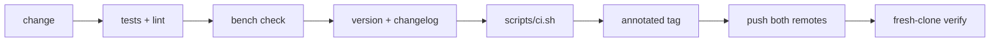
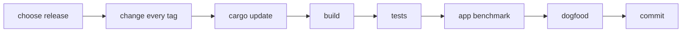

# Releasing ARK and upgrading apps

A git tag is the release. ARK is not on crates.io. Consumers pin a tag and upgrade on
purpose.

## Versioning

| Rule | Detail |
|---|---|
| One version | every crate uses `workspace.package.version`; they move in lockstep during `0.x` |
| `0.x` semver | minor (`0.4` to `0.5`) may break; patch (`0.4.1` to `0.4.2`) adds or fixes only |
| Public API | each crate's root re-exports and `ark_sdk::prelude`; internal modules may change freely |
| Prompt defaults | behavior, not API, but a material change is at least a minor bump with a changelog note |
| Persisted data | a newer ARK reads an older store; new fields use `#[serde(default)]`; fields are never removed or repurposed inside a major version |
| Events | new `HarnessEvent` variants or fields are expected; consumers match with `_ =>` and `..` |
| Tags | immutable. Never `git tag -f`, never delete and re-create. A fix after a tag, even a doc fix, is a new version. |
| Core | `ark-core` never gains a tool or domain name. This does not change with versions. |

## Remotes

| Remote | URL | Role |
|---|---|---|
| `origin` | `/Users/valentino/git/ark.git` (bare) | canonical |
| `github` | `https://github.com/0x00vb/ARK` | public copy; external consumers pin this URL |

Push `main` and every tag to both. `main` is always releasable.

## Release workflow

| # | Step | Command or file |
|---|---|---|
| 1 | Every change on `main` already passed tests, clippy and fmt | `scripts/ci.sh` |
| 2 | Benchmark: simulated always; live when the harness changed ([`BENCH.md`](BENCH.md)). If the simulated numbers moved on purpose, regenerate `bench/baseline.json` in that commit | `ark-bench run --out bench/baseline.json` |
| 3 | Pick the version (see the table above) and set it in the root `Cargo.toml`: `workspace.package.version` and the eleven internal `ark-*` dependency versions | `Cargo.toml` |
| 4 | Rename `## [Unreleased]` in `CHANGELOG.md` to `## [X.Y.Z] - YYYY-MM-DD` | `CHANGELOG.md` |
| 5 | Update `ROADMAP.md` (current version, state, limits) and the tag in the README install block | `ROADMAP.md`, `README.md` |
| 6 | Full check on the release commit, page tests included. Normal tests use the machine; WebKit tests serialize | `ARK_UI_PAGE_TESTS=1 scripts/ci.sh` |
| 7 | Commit `vX.Y.Z: <one line>`, then tag that commit | `git tag -a vX.Y.Z -m vX.Y.Z` |
| 8 | Push | `git push origin main vX.Y.Z && git push github main vX.Y.Z` |
| 9 | Verify as a consumer gets it: clone at the tag into an empty directory, check the tag matches the version, run every check | `scripts/verify-release.sh vX.Y.Z` |
| 10 | Move ARK Desktop's pin (its `CURRENT_STATE.md`, ARK pin) | |

`scripts/ci.sh` runs, in order: `cargo fmt --check`, the fast version and release-state check,
clippy with `-D warnings`, normal tests with Cargo's available parallelism, WebKit tests serially, a release build, and the simulated benchmark compared with
`bench/baseline.json`. A regression fails the run. Do not cap `CARGO_BUILD_JOBS` on a normal
developer machine. The test profile is intentionally unoptimized. Development and release
profiles keep their existing optimization settings. The completed `ark-ci-speed` experiment
measured a cold page-test build at 58 seconds instead of 99 seconds on the release Mac;
its 49 WebKit cases still took 92 seconds.
`scripts/verify-release.sh` uses a clean checkout at a stable path and a
persistent target cache, so the first verification is cold and later releases reuse it.

If step 9 fails, the tag stays. Fix on `main` and release the next patch version. v0.4.1
exists for exactly this reason.

## Upgrading an ARK app

| # | Step | Command |
|---|---|---|
| 1 | Read `CHANGELOG.md` from your version to the target. `Breaking` entries say what to change | |
| 2 | Change `tag = "vOLD"` to `tag = "vNEW"` on every `ark-*` dependency. Mixed tags compile two ARKs | `grep -rn 'tag = "v' --include=Cargo.toml .` |
| 3 | Refetch the tag and rewrite `Cargo.lock` | `cargo update -p ark-sdk` (plus any `ark-*` crate you depend on directly) |
| 4 | Build; the compiler finds API breaks | `cargo build --workspace` |
| 5 | Tests (drive loops with `MockProvider` or `ARK_PROVIDER=mock`) | `cargo test --workspace` |
| 6 | Your benchmark against your last report, when the release touched the runtime | your `ark-bench` workloads |
| 7 | Use the app for a real task in each front-end it ships | |
| 8 | One commit: manifests, `Cargo.lock`, any code changes; message names the old and new tag | |

Never pin `branch = "main"` or leave a `path =` dependency in a committed manifest. Both make
the build depend on whatever ARK looks like that day.

### Developing ARK and an app together

Swap the git dependencies for `path = "../../AIengineering/ark/crates/ark-*"` while you
work. Release ARK, then switch back to the new tag before committing the app.

## Rollback

| Situation | Do |
|---|---|
| An app upgrade breaks | `git revert` the upgrade commit (manifests and `Cargo.lock` go back together), `cargo build`, done. The old tag still exists and still builds. |
| A released ARK version is bad | Leave the tag. Fix on `main` and release a patch. Add a line under the bad version in `CHANGELOG.md` naming the fix version. |
| A bad commit on ARK `main`, not released | `git revert` it. Do not rewrite pushed history. |
