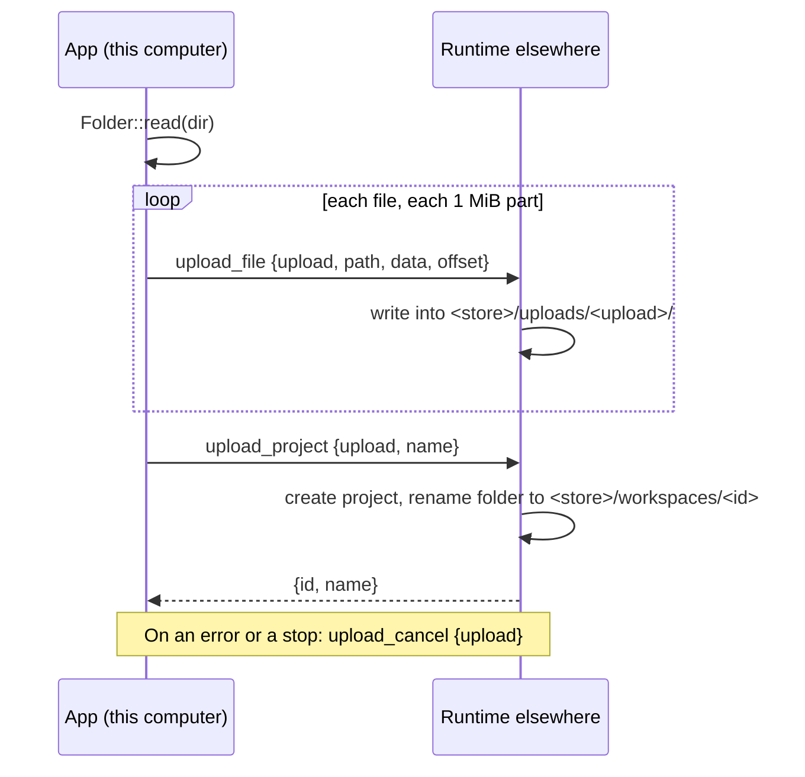

# 0030. A folder sent to a runtime elsewhere becomes a project there

Status: Accepted
Date: 2026-10-05

## Context
A runtime can run on a different computer (ADR 0016). The window can open it (ADR 0029). A
person has projects on their own computer. They must be able to copy one of these projects to
the runtime elsewhere. ARK Desktop uses this for "Copy to Cloud" (`ark-cloud/docs/CLOUD.md`,
D2). A self-hosted server needs the same function.

The protocol had no method that writes bytes. `file_write` writes text into the current project
only. The runtime had no method that makes a project from files.

| Option | Why not chosen |
|---|---|
| One call with an archive of the folder | The body limit is 32 MiB. A large call can fail after a long time and must start again |
| A new HTTP route for uploads | A second transport path. The page, the window and `Client` use only `call` |
| Write into a new project file by file | A copy that stops leaves a project with part of the files. ARK has no "delete project" |
| The cloud control plane writes the volume | It couples ark-cloud to the store format (ark-cloud ADR 0008 rejects this) |

## Decision
- The `Host` has three methods. They do not wait for a running turn.

  | Method | Does |
  |---|---|
  | `upload_file {upload, path, data, offset}` | writes one part (base64, max 8 MiB) of one file into `<store>/uploads/<upload>/` |
  | `upload_project {upload, name}` | moves that folder to a new project's folder in one rename; answers `{id, name}` |
  | `upload_cancel {upload}` | removes the upload |

- The client makes the upload id (8 to 64 letters, digits or `-`).
- At `offset` 0 the file starts again. Another offset must be the current end of the file.
- All paths stay in the upload folder (`ark_files::inside`). The runtime writes only files.
- A new name that is in use gets a number (`notes 2`).
- The runtime removes uploads that are older than one day.
- `ark_ui::remote::Folder::read(dir)` lists the files. It does not include links.
- `ark_ui::remote::send_folder(client, folder, name, go_on)` sends 1 MiB parts and then makes the
  project. It calls `go_on` after each part. If `go_on` answers false, or a call fails, it
  cancels the upload.
- `ark.action({ where: "project" })` puts an app's item in a project's menu. The item gets
  `{ project }`.

## Consequences
- The project shows only when all files are there. A stopped copy leaves no project.
- The copy contains the folder only. Chats, agents and traces stay on the first computer.
- Empty folders and links are not copied.
- A token holder can write files on the runtime. This is not a new permission: the Terminal
  panel can do the same (`REMOTE.md`, What a token allows).
- The limits of a copy (size, number of files) are for the app to set. ARK sets only the part
  size.

## Check
`crates/ark-ui/tests/serve.rs` (`a_folder_sent_from_another_computer_becomes_a_project_there`):
a stopped copy leaves nothing, a full copy has the same bytes, a name in use gets a number, a
path out of the folder is refused. `src/upload.rs` tests the parts and the ids.
`tests/page.rs` (`an_apps_action_on_a_project_is_in_its_menu`): the project menu item.
