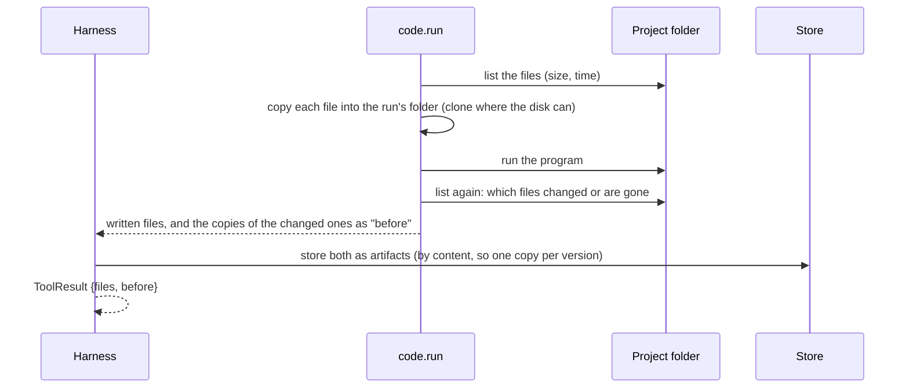

# 0034. A file a call changes keeps its version before

Status: Accepted
Date: 2026-10-05

## Context
Data work changes files in the project folder (ADR 0033). A program from `code.run` writes
straight into the folder, and `files.write` and `files.edit` save over a file. When a run
overwrites a source workbook or removes a file by mistake, the person has no way back. Files
already keeps what a call wrote (an artifact with the file's path, ADR 0021), so the person can
see every result. The version before the change is lost.

A program can write any file in the project, and nothing says which ones before it runs. So
the version before must be taken before the run, for every file the run could change.

| Option | Why not chosen |
|---|---|
| Copy only the files the program names | A program builds paths at run time; a missed file has no copy |
| Make the project read-only and apply the run's writes after | The program fails on a write; macOS and Windows have no overlay for this |
| Hard links of each file before the run | A program that saves in place (openpyxl, `open("w")`) changes the linked copy too |
| A version store beside the artifacts | A second store, with its own clean-up, of what the artifact store keeps already |
| Watch the folder during the run | Sees a write after it happened; the bytes before are gone |

## Decision
- A call that changes or removes a file keeps the file's bytes from before the call as an
  artifact: `ProducedArtifact::before(path)`. The engine stores it with
  `meta: {path, before: true}`. It is not a file the call wrote, so it is not in `files`.
- `HarnessEvent::ToolResult` and `Activity` have `before: [{path, artifact}]`, one entry per
  file. A front-end offers to restore each file.
- `Engine::restore_file(project, artifact)` writes the artifact's bytes back to its path in the
  project folder. First, it keeps the file as it is now in the same way. It answers
  `Restored {path, undo}`, so a restore can be undone. The window's call is
  `file_restore {artifact}`.
- `code.run` copies the project's files into the run's own folder before the program starts
  (`std::fs::copy`). It looks at the same files as `written_since`: no hidden folders and no
  package caches. After the run, each file that changed or is gone gets its copy as the version
  before. A file that was not changed keeps no version. All copies are removed with the run's
  folder.
- Limits: files up to 256 MiB, and 512 MiB in one run. A file that changed without a copy is
  listed in the output (`no_copy`), and the agent is told that this version before is lost.
- `files.write` and `files.edit` read the file before they save it. Then they keep it in the
  same way.
- The window: a file card from a turn that changed the file has Restore. Restore puts back the
  file as it was before the turn's first change. Then the card says Undo. A file that the turn
  removed gets a card that says Removed, with Restore.

## Consequences
- macOS (APFS) and Linux on btrfs or XFS clone a file and do not copy it. Measured on APFS
  (M-series Mac, 2026-10-05): three files of 850 KB take 1.2 ms, two of 200 MB take 0.4 ms, and
  200 files of 12 KB take 27 ms (each file costs a folder check and a clone). On ext4 and NTFS,
  a run first copies up to 512 MiB at the disk's speed. That is not measured yet.
- The store keeps every version before. They are stored by content, so a version kept two times
  takes the space of one. ARK does not remove old artifacts yet; this adds to that.
- A program that changes a file larger than 256 MiB, or a file past the 512 MiB in one run, can
  still lose the version before. The agent sees `no_copy` and can say so.
- The Terminal panel and programs that do not run through ARK keep no versions.
- The terminal front-end has no Restore yet. A person there asks the agent, or uses the
  window.
- A restore changes the file without a turn. The person sees it, but the agent sees the
  change only when it reads the file again.

## Check
- `ark-exec` `tests/run.rs` (`a_run_keeps_the_version_before_of_what_it_changed_or_removed`).
- `ark-files` (`a_save_over_a_file_keeps_the_version_before`).
- `ark-sdk` (`a_file_put_back_can_be_put_back_again`).
- Page test `restore`.
