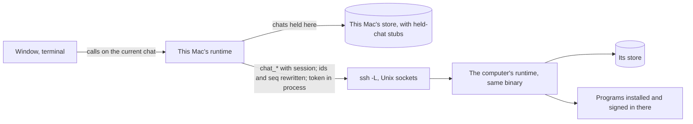

# 0052. A chat runs on the computer the person picks

Status: Accepted (plan gate passed after two reviews; the owner accepted 2026-10-07;
resource-location amendment accepted by the owner 2026-10-08)
Date: 2026-10-07
Amends: 0029 (the window switch for a person's own server), 0043 (a location is per chat, not
per project)

## Context
The owner (2026-10-07): "it should be easier to create a session on [my own server]. Not
running the entire ARK, but per session: a chat on my laptop for project X, and another on my
VPS for the same project. When creating a new chat it asks local, or my server. No copies
necessary." Subscriptions (Claude Code, Codex, OpenCode, Cursor) matter most, API keys too, and
the experience stays the same in both places. Owner decisions the same day: bring changed files
back (not a git branch per chat); a prebuilt Linux build per release; the per-chat place
replaces the window-wide This Mac | My machine switch.

| Today | Where | What gets in the way |
|---|---|---|
| A window shows one runtime's page: This Mac, or My machine through `remote::visit` | ADR 0029, Desktop `place.js` | The place is per window. A project's chats cannot run in two places |
| My machine needs Docker, a DNS name, ports 80 and 443 or Tailscale, then `token pair` and a typed address and code | ADR 0043 step 3, Desktop `docs/REMOTE.md` | Four things to copy by hand before the first chat |
| A folder sent to a runtime becomes a new project. `send_folder` sends every file, without modes, links or deletions | ADR 0030, `remote.rs` | One project becomes two rows; nothing comes back; `+x` is lost |
| A link: name, address, token, in the app's process; four fixed calls forwarded; nothing copied into the local store | ADR 0043 step 4, `ark_interact::links` | Only the attention list crosses runtimes |
| The host's chat calls act on its current chat (`send` -> `start_turn` -> `self.cur()`; also `model`, `command`, `context`, `trace`, `workspace`). Approval ids and event `seq` are per host | `ark-ui/src/host.rs` | Forwarding `open_session` then `send` to a server would move the server's own window and race its other clients |
| Subscriptions through the vendor's own CLI (`ark_model::cli`), programs through ACP (`ark-acp`); setup is prose in the catalog | ADR 0012, 0043 step 2 | Each needs the program installed and signed in on the computer that runs the chat |

## Decision
A chat has a **place**: the computer whose runtime holds it and does its work. It is picked
when the chat starts and does not change. **Who answers** (ARK's agent on a model, a
subscription, a program) stays the chat's other choice. The two never depend on each other in
code: a server runs the same runtime as This Mac, so an agent that works on one works on the
other once it is installed and signed in there.

The invariant is stronger than where the agent loop runs:

> If a chat runs on computer X, every resource opened or operated from that chat belongs to
> computer X unless the person explicitly moves or copies it elsewhere.

The window draws a remote resource here. It never makes that resource local. Terminal input,
file reads and edits, spreadsheet and document edits, processes, artifacts, evidence, app
panels, browser input and every later action on an already-open tab go back to the runtime that
owns the resource. A missing route, an old runtime and a lost connection fail closed. None may
fall through to this computer.

This revisits the option ADR 0029 rejected ("every method needs to know where a project is").
It is now needed per chat, so the protocol gets chat-addressed calls instead of a forwarding
`Host`: only the calls of a chat held elsewhere cross, and they name the chat.

### Resource location and identity (amendment, 2026-10-08)

A chat summary carries the location its resources use:

```text
ResourceLocation {
    runtime,    // stable id of the runtime whose store and programs own it
    project,    // the project replica in that runtime
    session,    // the chat that opened it; the destination derives its project from this
}

ResourceRef {
    location,
    kind,       // terminal, file, process, artifact, invocation, browser, extension, ...
    id_or_path, // opaque id in that runtime, or a path inside that project
}
```

`runtime` and `project` are identities, not display names or filesystem paths. A name such as
`vps` may change without changing a reference. The origin host keeps the token and the mapping
from runtime id to transport. Neither enters the page.

Every tab captures a `ResourceRef` when it opens. Its key includes the reference, and every
later read, write, key, pointer event and refresh sends it. Switching to another chat cannot
rebind an open tab. Events carry the same reference. Two runtimes may issue the same artifact,
terminal or process id without a collision.

The destination never trusts the `project` in a reference. It resolves `session`, derives that
chat's project and checks that the runtime and project equal the claim. A file reference is then
resolved inside that project's folder; an artifact or invocation inside that project (or its
existing agent child projects); a terminal, process or browser only when its kept owner matches
the project or session. A mismatch is refused.

Resolution is non-switching. The resource path first looks in live current, background and
addressed conversations, then reads the stored session and project directly. It never calls
`open_session`, changes `Host::current` or takes a chat away from another window. Only an
operation that needs live conversation state, such as focus for the next turn, materializes a
conversation, and it does so as a background addressed conversation. A tab continues after its
opening chat is evicted from memory and after the runtime restarts, subject to the resource's
own persistence.

Files are project resources, so two chats on one project replica may open the same file even
though each reference records the chat that opened it. Their version guards still decide a
write. Terminals and processes are shared by that project. A person's browser page is owned by
the chat, so input in one chat cannot change another chat's page or an agent's browser.

A shared project resource has aliases, not one privileged reference. Opening its pane registers
the validated, session-bound `ResourceRef` as a subscriber to the intrinsic terminal or process
id. The destination fans each event out once under every active alias. Closing a pane removes
that alias, not the shared resource unless the person explicitly closes or stops it; forgetting
a chat removes all of that chat's aliases. Two chats on one replica can therefore watch the same
terminal or process without either receiving a reference that claims it was opened by the other.
The subscriber table is ephemeral and rebuilt by reopen or reconnect; replay or current state
fills the interval without duplicating events.

### One routing boundary

The page makes one `resource {ref, operation, input}` call. The origin host does exactly one of
two things:

| `ref.location.runtime` | Action |
|---|---|
| This runtime | Validate the session and project, then call the resource implementation with that explicit project |
| Another runtime | Find the exact held chat by session, runtime and remote project, then send `chat_resource` through its existing authenticated link |

The destination's `chat_resource` derives the project from the session and calls the same
resource implementation. The resource implementation never reads `Host::project()` or the
window's current chat. This makes local and remote one path rather than parallel backends.

The old top-level `term_*`, `file_*`, `proc_*`, `artifact`, `invocation`, `picture`,
`run_action`, `focus` and project extension handlers are removed from the ordinary dispatcher.
They exist only as resource operations. Setup and sign-in return a terminal `ResourceRef`; the
setup-only `chat_term_*` path goes too.

Calls while a held chat is shown are deny by default:

| Class | Calls | Where |
|---|---|---|
| Window and relationship | `hello`, `places`, Computers, Devices, the combined attention list, project and chat navigation, adding a local project, `place_changes`, `place_bring` | the origin runtime, explicitly |
| Chat control | send, stop, steer, approve, transcript, model, rename, context, trace | the chat's runtime through the existing addressed calls |
| Resource | Terminal; Files and uploads; text, spreadsheet and document editors; processes; artifacts, versions, pictures, evidence and invocations; focus; actions and project extension panels; the person's Browser | `resource` locally or `chat_resource` remotely |
| Runtime setup | models available there, program install/sign-in, a key the person chose to send | the chat's runtime, explicitly |
| Unknown | any method not classified above | refused while a held chat is shown |

Adding a host method therefore requires choosing its class. An unclassified method can never
reach the origin runtime by accident.

An app handler also declares its class when it is registered:

| Handler scope | Context and route |
|---|---|
| `ProjectResource` | Gets the explicit project from the `ResourceRef`; follows that resource's runtime |
| `WindowLocal` | Gets no remote project; runs only in the origin app process |

There is no inferred scope. A handler without one does not compile. ARK Desktop must classify
its project operations (`desktop.run`, its workspace and project file operations) as
`ProjectResource`, and account, Cloud, packaging and machine operations as `WindowLocal`.
Other consumers do the same. This is a public API change in ARK first, followed by each
consumer's pinned update.

Uploads are resources too. Their staging id is scoped to the runtime and opening session;
parts, apply and cancel cannot meet another chat's upload. A dropped file in a remote chat goes
to the remote project replica. It reaches this computer only through `Bring to this Mac`.

`focus` belongs to a conversation, not a host. A panel on one chat cannot become context for
another chat's next turn.

Processes are filtered by the explicit project folder for list, output and stop. Process events
are resolved back to that project at the destination, filtered there, tagged with the resource
location and only then relayed. The same applies to terminal and browser events. A guessed id
from another project is not authority.

### The Browser on another runtime

The existing Desktop Browser is a local webview, and an iframe in a served page also navigates
locally. Forwarding `frame_check` would not move DNS, cookies, `localhost`, WebSockets or egress,
so neither is used for a remote `ResourceRef`.

For a remote location, `ark-browser` owns a person-driven page in Chromium on that runtime,
separate from every agent page. `ark-ui` transports bounded rendered frames and input; the page
draws them. CDP and its debug port never leave the destination runtime.

| Part | Rule |
|---|---|
| Ownership | One fresh browser context per chat, kept while the runtime lives; cookies and pages are isolated between chats |
| Navigation | HTTP and HTTPS, typed addresses and search; canonical URL, title, loading and failure come back from the remote page |
| Rendering | Frames fit the pane's viewport and scale, with bounded dimensions, rate and bytes; dynamic DOM and WebSocket changes produce new frames; a slow client receives the newest frame, not an unbounded queue |
| Input | viewport resize; mouse move, down, up and click; wheel; key down and up, text, Tab, Enter, Escape and modifiers; focus and blur |
| Controls | back, reload, stop and close; redirects and same-tab navigation update the address; a popup replaces the same page in v1 |
| Reconnect | Reattach to the kept page when the runtime survived. If its page or browser ended, say so and offer to reopen; never open the local browser |
| Availability | No Chromium, a browser crash, an offline runtime or a refused address is a visible unavailable state |
| Network | Public URLs, DNS, cookies, remote `localhost`, private addresses and WebSockets all use the destination runtime's browser and network |
| Private pages | A person may navigate the Browser they opened. An agent's browser keeps ADR 0046's project-process constraint; `present` does not enlarge the agent's authority |

The rendered Browser is a focusable image surface with a visible focus ring and an accessible
name. Its canonical URL, loading state and errors remain ordinary accessible text outside the
bitmap. `Ctrl+Option+Escape` (`Ctrl+Alt+Escape` off macOS) always releases Browser capture and
is never forwarded; after release, ARK's shortcuts and Tab order work normally. The Browser
control's accessible description says the release chord without adding permanent helper copy.
CDP target creation is watched: a popup replaces the tracked target in the same surface and the
old target closes, so v1 cannot leave an untracked popup or context.

Cut from v1: Forward, a shared signed-in profile, downloads, file uploads in a page, clipboard
transfer, site permission prompts, audio, video and DevTools. A missing current Browser behavior
shows unavailable; it never invokes the local webview. The ordinary local Browser keeps its
native webview behavior.

Browser acceptance uses the surface, not a direct CDP test. It covers viewport resize, loading
and canonical URL, redirect, click, text entry and form submission, wheel scroll, Back and
Reload, a dynamic DOM change, a WebSocket update, disconnect and reconnect, close cleanup, two
chats' isolated cookies and pages, missing and crashed Chromium, and oversized or rapid frames
with the rate, size and newest-frame backpressure limits. One test runs a server on the same
`localhost` port on each computer with different content; a remote chat can only show the
remote content. A public endpoint also observes the destination runtime's request.

### Terminal continuity

A project terminal is one resource with a stable id and generation while its PTY lives. Output
has a monotonic byte cursor and a bounded 256 KiB replay buffer. `terminal_read {after,
generation}` returns bytes after the cursor, or says that the generation ended. Live output
events carry the next cursor and generation.

On reconnect, the tab reads from its last cursor. `terminal_open` for the same project returns
the existing resource and generation; it never creates a second PTY while that one lives. If
the process exited while disconnected, the read includes its remaining output and ended state.
If the runtime restarted, the generation is gone and the tab says the terminal ended. Close
ends the PTY and removes its project mapping. Tests cover output and exit while disconnected,
no duplicate PTY or output after reconnect, and close cleanup.

If `after` is older than the replay buffer's base cursor, `terminal_read` returns `gap: true`,
the base cursor and the retained suffix. The pane inserts a visible, non-terminal-text divider,
“Earlier output unavailable”, before that suffix. It does not imply that the missing bytes ran
again. Replay never splits a UTF-8 character: the returned start advances to the next complete
character and reports that cursor. Tests roll the buffer over with a multibyte character at its
boundary, both while the PTY lives and after it exits.

### Replica and concurrent work

The default remains one project replica per `(origin project, destination runtime)`. A second
chat for that pair reuses it. Another project or another destination gets another replica.
The manifest, not Git, defines what each side last shared.

Git may later make the first copy cheaper, but cannot change the result and is never required.
ARK creates no branch, worktree, commit, merge or pull request. A future workload with
concurrent writers may add an isolated task workspace: a generic copy, snapshot, reflink or
overlay. A Git project may implement that abstraction with a worktree. It is not part of this
change.

Several chats may currently write one replica. File editors use version guards. Tool, terminal
and process writes are found by the manifest. ARK does not claim stronger isolation until the
generic task-workspace trigger in `ROADMAP.md` is met.

### Failure, reconnect and reconciliation

| Event | Behavior |
|---|---|
| Link goes down | Open tabs keep their last rendered state. Mutating controls are disabled. Nothing is queued or redirected locally |
| Link comes back | Files and processes refresh; a browser reattaches to its page; a terminal reattaches to the project's kept PTY or clearly says it ended |
| Runtime or browser restarted | Stored chat and project records return; ephemeral terminal/browser handles say they ended and may be reopened |
| Old remote has no resource protocol | The surface says that the computer must be updated. No fallback. Reach updates managed computers before a new chat; address-linked computers must be updated by their owner |
| Transfer interrupted | The receiver keeps parts outside the project. Each side advances its own manifest only after its own filesystem apply. A transfer id, replica epoch and exact packed-content manifest stay pending until the origin acknowledges the receiver's apply receipt. Retrying that id is idempotent and converges; it never reapplies over a file changed since the receipt |
| Both sides changed one file | `Bring to this Mac` asks Keep this Mac's or Take the other computer's. It never merges automatically. The other version is kept before the choice |
| Remote changed, local did not | `Bring to this Mac` applies the remote change and keeps the local version before |
| Local changed, remote did not | The next send may update the remote replica before new work. It never overwrites a remote change since the manifest |
| Work runs in the replica | A send does not write under it. The chat uses the current replica and the next chat retries the send, as the existing result records |

Remote edits made through Files, an editor, a spreadsheet, a document, Terminal, a process, an
agent or a browser download if one is added later all appear in the same `place_changes` and
explicit `Bring to this Mac` flow.

This is not a distributed transaction. If the receiver applied the files and the acknowledgement
was lost, its kept receipt answers the retry. The origin then advances its manifest and settles
the receiver. If either side changed a planned file after the receiver applied it, the retry
returns it as a conflict instead of overwriting it. Tests cut the link before upload, after the
receiver's apply and before settlement, then retry and compare both files and both manifests.
One reconciliation lock per replica serializes epoch checks, filesystem apply and manifest
advancement across every chat that shares it. A sender records the manifest it packed, never a
later scan of the folder. If the folder changes during packing, that plan is refused and retried.
Settlement reports a stale epoch as a protocol value. A transport failure is never interpreted
as stale, so the pending plan and apply receipt remain until an acknowledgment arrives.

### Migration

- Existing v0.15 held-chat and copy records need no rewrite. `ResourceLocation` is derived from
  the held chat's runtime id, remote project and session; local summaries derive it from the
  current runtime, project and session.
- Open tabs are presentation state and are not persisted. Reloading after the upgrade rebuilds
  them with resource references. During one process, a tab always keeps the reference it opened
  with.
- Managed computers are updated by Reach before they take new work. A missing
  `chat_resource` is reported as an old computer, not retried through old per-method calls.
- Direct current-project resource calls and setup-only terminal forwarding are removed in the
  same change. There is no compatibility layer inside the runtime.
- The protocol remains transport-neutral. SSH Reach, an HTTPS address and Cloud all carry the
  same `chat_resource` call and resource events.

### Amendment acceptance

The implementation is not complete until one packaged runtime on a reachable Linux computer,
with Chromium installed, proves every row through the ordinary window:

| Resource | Proof |
|---|---|
| Identity | The two runtimes deliberately have the same artifact, process and terminal ids and the same file path with different contents; every tab reads only its reference |
| Switching | Open each remote tab, switch to a local chat and operate the old tab; every operation still lands remotely |
| Shared resources | Two chats on one replica open the same terminal and process; both aliases receive each event once, closing one leaves the other live, and forgetting either chat removes only its aliases |
| Terminal | `pwd` and the hostname are the Linux computer's; output and exit while disconnected replay once after reconnect |
| Files | A remote-only text file opens and edits there; the local file stays unchanged until Bring |
| Spreadsheet and document | Real `.xlsx` and `.docx` files edit on the Linux copy, reopen there, then arrive through Bring |
| Processes | Only the remote project's list and output show; Stop ends that process and cannot name another project's id |
| Artifacts and evidence | Same ids on both runtimes open the remote bytes, picture and invocation; a forged reference is refused |
| Browser | The Browser surface passes the interaction matrix above, including distinct same-port `localhost` content and remote public egress |
| Replicas | Two chats for one origin project and destination reuse one replica; another origin project and a second origin runtime do not |
| Reconciliation | A remote editor change appears in `place_changes`; local and remote edits of one file produce one Keep/Take choice; each choice converges |
| Failure | Disconnect during a read, edit, terminal stream, browser input and each transfer phase; no operation lands locally, no mutation queues silently, retry is safe |
| Old runtime | A v0.15 destination says it must be updated for a resource operation and nothing runs here |

Automated tests cover the same boundaries with two runtimes, two projects and two origins,
including traversal and links outside the folder. The real-machine run records the host kind,
ARK build, Chromium build and evidence without storing its address, keys or tokens.

### What the person sees

| Moment | Sees |
|---|---|
| A new chat | Beside the model, a place chip: `This Mac` (`This computer` off macOS). Its menu: This Mac, the person's computers, Add a computer. Fixed after the first message; afterwards a chat held elsewhere has a small mark in the sidebar and the chat header |
| Add a computer | The host names `ssh -G` resolves from `~/.ssh/config` (Include and Match honoured, no wildcards), and a field for `user@host` |
| The first chat on a computer | One progress line in the empty chat while ARK sets it up (Reach). A failure names the step and offers Try again |
| The first chat for a project there | The size of what goes, and a question above 500 MB or 20,000 files. The project stays one row |
| A chat working there | The same chat as on This Mac. Closing the laptop does not stop it. Its questions wait in This Mac's tray (ADR 0043 step 4). A phone gets them only if that computer also has the public address route (ADR 0047); a computer reached only over SSH has no address a phone can reach |
| The computer does not answer | Its held chats stay listed, read only, with "vps is not answering" and Try again. Nothing is typed into them |
| After a turn, when the copy differs from what This Mac has | One line: "3 files changed on vps · Bring to this Mac" |
| A program not ready there | The model menu shows it greyed with one word: Install or Sign in. Each runs that program's own step on that computer |

### Layers

| Layer | Crate | Owns |
|---|---|---|
| Chat-addressed protocol | `ark-ui` host, words in `ark-interact` | `chat_*` calls that name `{session}` and never touch the host's current chat. Used by a runtime that holds chats for another |
| Held chats | `ark-interact` (`links`), `ark-store` | A stub per held chat on This Mac (`HeldChat {runtime_id, session, project, title, updated}`, `serde(default)`), so the list survives a restart and an offline computer. The host routes the person's current chat to its link when it is held |
| Project copy | `ark-ui` (`copy`), a manifest record in `ark-store` | Send, compare, bring back by manifest (below) |
| Reach | new crate `ark-reach` (process orchestration, not presentation) | Hosts via `ssh -G`; setup; a tunnel. The system `ssh` does the connection with the person's config, keys and agent. ARK reads the resolved config to list hosts and never reads keys. The app supplies a `ServeContract` type: how its binary serves on a socket with tokens, creates a token, says its version |
| Programs on a computer | `ark-acp` catalog, `ark_model::cli` | Per program, as data: find, install, sign in, check. Asked of the chat's runtime, never assumed from This Mac |
| The app | ark-desktop | Its Linux builds and their SHA-256 inside the app; Settings › Computers in place of Settings › My machine; the migration of today's My machine |



### Chat-addressed protocol

| Call on the computer | Replaces, for a held chat | Note |
|---|---|---|
| `chat_new {project, model}` | `new_session` | Answers the session id. The computer's own current chat is not changed |
| `chat_send {session, text}`, `chat_cancel {session}`, `chat_steer {session, text}` | `send`, `cancel`, `steer` | The turn runs as a live chat in the background (ADR 0017) |
| `chat_read {session}` | `open_session`'s history and live state | |
| `chat_events {session, after}` | `events` filtered to the chat, plus its approvals | The existing event stream, filtered to the chat; `after` resumes it. Not a poll |
| `chat_approve {session, id, decision}` | `approve` | |
| `chat_model {session, model}`, `chat_context {session}`, `chat_trace {session}` | `model`, `context`, `trace` | |
| `chat_resource {session, ref, operation, input}` | every operation on a resource opened from the chat | The destination derives and validates the project before using the shared resource implementation |

Ordinary project resources cross only through `chat_resource`. They do not get one forwarding
call per surface. Settings, account, packaging, connections and other `WindowLocal` operations
stay at the origin by explicit classification. Anything not classified is refused while a held
chat is shown.

On This Mac: when the current chat is held, the host sends the same calls through the link. An
approval id from a computer becomes `<runtime_id>:<id>` before any client sees it, and its
events are numbered again into This Mac's own `seq`. `hello` replays a held chat's live events
from `chat_events`. A computer is known by a store id: new, made once by its runtime, stored, and
returned by `hello`. The terminal (`ark-cli`) works the same way through the same host: `/chats`
lists held chats with their place; opening one sends to its computer.

### Reach: setting up a computer

One SSH connection per setup (`ControlMaster`, `ControlPath` in a 0700 folder under the store,
short enough for the socket limit). Every `ssh` is `ssh [options] -- <host>`; the host and user
are checked against `[A-Za-z0-9._@-]` and a resolved `ssh -G`; every remote argument is quoted.
Host keys follow the person's `known_hosts`. ARK never passes `accept-new` or
`StrictHostKeyChecking=no`.

| Step | Does | Fails with |
|---|---|---|
| 1. Connect | `ssh -o BatchMode=yes -- host true`. An unknown host key, or a key with a passphrase not in the agent, opens the system `ssh` in a terminal sheet once, so the person answers `ssh` itself. A changed host key stops setup | "Could not reach vps: <ssh's last line>" |
| 2. Look | `uname -sm`, glibc version, free disk, an ARK already there and its version, `systemd --user` and linger, an `sshd` that turns socket forwarding off (`AllowStreamLocalForwarding no`, `DisableForwarding yes`) | "vps runs <system>; ARK runs on Linux x86_64 and arm64", or "vps does not allow forwarding (sshd_config)" |
| 3. Install | This Mac downloads the build for that target, checks it against the SHA-256 compiled into the app, and sends it over the SSH connection (the computer may have no `curl` or no way out). Kept under `~/.local/share/<app>/`, with the previous one | "The build did not match; nothing was installed". The release builds the Linux targets first, so their hashes go into the app. A development build takes a local server build from `ARK_SERVER_BUILD` and its hash from the file itself |
| 4. Start | A `systemd --user` service serving on a Unix socket (mode 0600, in a 0700 folder). Linger on (`loginctl enable-linger`); if refused, a terminal sheet runs `sudo loginctl enable-linger <user>` with the person's consent (that stream, with the password, is never stored or traced); if still refused, the chip shows "Stops when you log out of vps" | the service's last log lines |
| 5. Pair | The `ServeContract`'s token command, named after this computer, over the same connection. The token goes to the keychain, never to the screen | |
| 6. Tunnel | `ssh -N -o ExitOnForwardFailure=yes -o StreamLocalBindUnlink=yes -L <local socket>:<remote socket>`, the local socket in a 0700 folder, both paths under 104 bytes. Kept by the app, started again with backoff after sleep or a network change. The link speaks HTTP over that socket (step 1 checks reqwest 0.12's Unix socket support, else a hyper connector), and HTTPS for a computer reached by address | the held chats show "not answering" |

Updates: when the app's version changes, the next reach updates the computer if nothing works
there (no turn, task or schedule running), else after. Remove (Settings › Computers): stops the
service, revokes the token, forgets every key ARK sent there, and asks whether to delete the
store there.

Today's My machine (an HTTPS address and a token in the keychain, `connection.json`) becomes a
Computer reached by address, without SSH. Its chats are held chats like any other.

### Project copy

| Rule | Detail |
|---|---|
| Transport | Over SSH: a `tar` stream through the same connection, which keeps modes and links inside the folder. `upload_parts` stays for Cloud and for a computer reached by address |
| What goes | A git folder: `git ls-files -co --exclude-standard` plus `.git` on the first send only; submodules are not sent in v1. Other folders: everything except the usual build and package folders (`target`, `node_modules`, `.venv`, `__pycache__`, `dist`, `build`), with the size asked above the limit |
| `.git` | Sent once, so the copy has the history and the branch. Never again in either direction: commits on the computer stay there (push them as usual), and files brought back show as changes in This Mac's working tree |
| The manifest | Per copy, on both sides: path, size, mode, SHA-256, written at each send, each bring back and each choice on a file changed on both sides. `.git` is never in it. It is the only record of "what the copy had". A rename of the computer does not break it (keyed by the computer's store id) |
| A later send | Before a chat starts there: files whose This Mac version differs from the manifest. Never one that the computer changed since the manifest (that file is listed in the chat's first line). Deletions are sent too. If a turn or task works in the copy, the send waits until it ends, and the new chat says so |
| Bring back | The computer compares its folder with the manifest: changed, new, deleted, mode changes, whatever made them (a chat, a program, a process, the Terminal). New files follow the send's rules (`git check-ignore` there, or the same folder list), with the size asked above the limit, so build output stays there. This Mac writes them, keeping its own versions before (ADR 0034), so one step undoes it |
| Bring back trusts nothing | The computer sends a `tar` stream; This Mac reads it with ARK's own code, never the system `tar`. It refuses a path outside the project (`ark_files::inside`, no `..`, no absolute path), takes a link only when it points inside the project, never writes through an existing link, and drops setuid and setgid bits |
| Changed on both sides | Per file: Keep this Mac's, or Take vps's. The other side's version is kept as a version before, and the manifest records the choice, so the file is not asked about again |
| Not done | Two-way sync while a chat works; chats, agents and traces moving between computers |

### Who answers, on any computer

| Way in | Signs in | On a computer |
|---|---|---|
| A subscription: Claude Code, Codex (`ark_model::cli`, ADR 0012) | The program's own login, on the computer that runs it. ARK never reads it | Sign in runs the program's login in a terminal sheet attached to the computer: the link to open on the Mac and a code to paste, or a device code. That stream is never stored or traced |
| A program as worker (ADR 0043 step 2), OpenCode and Cursor later | The same | The same |
| An API key | The key the person saved in ARK | Sent to the computer's `FileSecrets` (ADR 0028) once per key, after the person agrees. A key changed on This Mac is offered again on the next reach. Remove forgets them |
| ARK's models (the Account) | A key per computer from the account | Later, with Cloud: the computer signs in itself |
| A local model on This Mac (Ollama) | | Greyed there: "Only on This Mac" |

## Options not chosen

| Option | Why not |
|---|---|
| The agent's loop on This Mac, its tools on the computer over SSH | Work stops when the laptop sleeps. Every tool would need a second backend. Every call pays network time |
| Forward `open_session` and `send` as they are | Moves the computer's own window and races its other clients (plan review) |
| The window switch per runtime (today) | The place belongs to the chat, not the window |
| A transport per runtime in the page, the token in the page | ADR 0043: a token never leaves the app's process. Forwarding in the host also serves the browser and the terminal |
| Docker on the computer | Needs Docker and a published image; one static build is one file (owner) |
| A git branch per chat | Code projects only (owner chose files) |
| Changes from ARK's records (versions before, a worker's folder diff) | They miss `process.start`, the Terminal, delegated tasks and hidden folders (plan review). The manifest misses nothing in the folder |
| Carrying a subscription's token from This Mac (`claude setup-token`) | ARK would read a vendor credential (ADR 0012) |
| A TCP port on 127.0.0.1 for the tunnel | Other users on a shared computer reach it. Unix sockets with 0600 do not |
| `remote::visit` for these computers | Its URL carries the token |

## Consequences
- ADR 0029's switch goes for the person's own computers; `visit` stays for Cloud. Desktop's
  Settings › My machine becomes Settings › Computers.
- ADR 0043's "a project's location" becomes a chat's place. A project can have chats in
  several places.
- A computer reached only over SSH sends no phone notifications. The public route (Caddy, `token
  pair`) stays for people who want them.
- The headless build has to run on stock servers: rustls instead of native-tls, `FileSecrets`
  instead of the kernel keyring, glibc no newer than Ubuntu 20.04's or musl (step 0).
- Run code is off on these computers in v1 (`uv` and bubblewrap; Ubuntu 24.04 blocks user
  namespaces). The chat says so once.
- Not in v1: Windows as This Mac (no `ControlMaster`, Unix sockets differ), OpenCode and Cursor
  (step 7), ARK's models on a computer.

## Order of work
Each step ends with its check. Container tests run only with `ARK_TEST_SSH=1` (they need Docker).

| # | Step | Repo | Done means |
|---|---|---|---|
| 0 | A headless build that runs on stock servers | ark-desktop, ARK deps | The `--serve` build starts, serves on a Unix socket, stores keys in `FileSecrets` on Ubuntu 20.04, 22.04, 24.04 and Debian 12, x86_64 and arm64 (containers) |
| 1 | Chat-addressed calls and held chats | ARK | Two runtimes, A linked to B. A chat placed on B: stub on A, a turn streams on A, stop, steer, a question answered on A. B's own window and a second client of B stay on their chats while A sends. A's and B's approval ids collide and are still told apart. B's token in no answer, event or log of A. B down: A lists the chat read only; A restarted: still listed. The terminal opens it too |
| 2 | Project copy | ARK | First send keeps modes and skips ignored files; a size question above the limit; a later send carries only changes and deletions; a computer change is never replaced; a send waits for work in the copy; Bring back finds a file written by a process and one in a hidden folder; a `cargo build` there brings back nothing from `target/`; a link to `~/.ssh` made there is refused; both sides changed: Keep or Take, the other kept as a version before, and the next send goes on; `.git` sent once |
| 3 | Reach over SSH | ARK (`ark-reach`) | Against `sshd` in a container: hosts from `ssh -G` with Include; `-oProxyCommand=` and quotes in names refused; a changed host key stops setup; setup from nothing; again does nothing; a build with the wrong hash refused; linger refused shows the mark; the tunnel closed mid-turn and the turn finishes on the computer; the tunnel back after `sshd` restarts; Remove revokes the token and forgets keys |
| 4 | The place chip and Add a computer | ARK shell | Page tests: an empty chat offers places; fixed after the first message; the mark; setup progress and its failure; an offline computer's chats read only; light and dark, 1280 and 390 wide |
| 5 | Programs on a computer | ARK | A spike per program first: Claude Code and Codex install and sign in on a server with no screen (Codex device auth). Then: the model menu asks the chat's runtime; install and sign in run there; the sign-in stream is not stored or traced; a key sent after the person agrees; a local model greyed |
| 6 | ARK Desktop | ark-desktop | Settings › Computers; today's My machine migrated; the native dogfood on a real VPS: a Claude Code subscription chat on the VPS and one on This Mac in the same project, the laptop closed, the work done, files brought back |
| 7 | OpenCode and Cursor | ARK (`ark-acp`) | Catalog entries, ADR 0043's step 0 checks per program |
| 8 | Second consumer | ARK (`examples/writing-agent`) | The writer places a chat on a computer with its own `ServeContract`; a chapter changed there comes back |
| 9 | Resource locality amendment | ARK, then consumers | Every resource surface uses a stable `ResourceRef`; held chats deny unclassified calls; the Browser and terminal pass their continuity matrices; two-runtime automated tests and one real Linux computer prove no remote operation lands locally. ARK changes its public handler registration first, then Desktop and the writer classify every handler and update their ARK pin |

## Results (2026-10-07)

Built on branch `places` (ARK) and `places` (ARK Desktop), not committed yet.

| Step | Built | Evidence |
|---|---|---|
| 0 | rustls only (no OpenSSL on Linux); `ArkUi::serve("unix:…")` 0600 in a 0700 folder; `remote::Client` on `unix:`; Desktop `scripts/linux-builds.sh` (Debian 11, glibc 2.29 at most) and `linux-check.sh` | `tests/socket.rs` (4); 8 of 8: Ubuntu 20.04, 22.04, 24.04, Debian 12 on x86_64 and arm64 |
| 1 | `chat_*` calls (`host.rs`), held chats (`ark_interact::held`, `host/held.rs`), a relay per place, ids `<runtime id>:<id>`, `Effect::Open` for `/resume`, `/chats` | `tests/places.rs`: placed and streamed, B's window stays, ids told apart, steer and stop, away and after a restart, the terminal |
| 2 | `ark_ui::copy` (manifest, select, changes, plan, pack, apply), `host/copying.rs` (`copy_*` there; `place_changes`, `place_bring` here), `Engine::keep_before` | `tests/copy.rs` (14); `places.rs` the project goes with the chat and its changes come back |
| 3 | crate `ark-reach` | 22 unit tests; `ARK_TEST_SSH=1` against `sshd` and a `systemd --user` container |
| 4 | the place chip, the line above the composer (Bring back, a choice per file, not answering), marks in the sidebar and header, Settings › Computers (`computers.js`; SSH hosts, `user@host`, or an address and a code) | page tests `places`, `places_away` with pictures (light, dark, 390 wide) |
| 5 | the model menu asks the chat's computer; Install and Sign in run the program's own step there in a terminal sheet (`chat_setup`); a key sent when asked, forgotten on Remove only while it is still the key sent (by its SHA-256; not proven by a test: saving a key there checks it with the provider over the network) | spike in Ubuntu 24.04: Claude Code installs without Node (`claude.ai/install.sh`), signs in with a pasted code; Codex with `--device-auth`; `places.rs` a program signs in on the server from here |
| 6 | Desktop: `src/computers.rs` (its contract, builds by architecture, `ARK_SERVER_BUILD`), Settings › My machine and the window switch gone, a paired My machine moved to Computers once | `tests/computers.rs` with `ARK_TEST_SSH=1` and Desktop's arm64 build: setup, a chat there asks here, `sshd` restarts with the question open, the file comes back, Remove revokes the token |
| 7 | not done | OpenCode 1.4.0 speaks ACP itself (`opencode acp`), takes its config in `OPENCODE_CONFIG_CONTENT`, lists models in `session/new`; its free models refuse clients other than its own app, so the asks-before-writing check needs a signed-in provider. Cursor is not installed here |
| 8 | the writer: `--version`, `--revoke-token`, its own contract, Computers with `WRITER_SERVER_BUILD`; ARK `scripts/linux-build.sh` | `tests/computers.rs` with `ARK_SERVER_KIND=writer`: a chapter saved there with the writer's own tool comes back |
| 9 | One typed resource boundary, location-bound tabs and events, project and window handler scopes, terminal replay, a remote Chromium surface, resumable transfer parts and apply receipts | `ark-ui` tests with two runtimes and two chats; 37 WebKit shell scenarios; `ark-browser` surface, missing-browser, crash and frame-bound tests; Desktop's full check; a current Linux x86_64 server build on a real remote machine |

Where it differs from the plan:

| Plan | Built | Why |
|---|---|---|
| A send waits while work runs in the copy | The chat starts without the send and says so; the next chat sends | A wait with no end in sight is worse than a chat on the copy as it is |
| A local model greyed "Only on This Mac" | The menu lists the computer's own: its Ollama when it runs one | The computer answers for itself |
| "Bring back" undone in one step | Each file brought back keeps its version before (ADR 0034); no single Undo yet | A new file has no version to put back; one Undo needs a list of deletions too |
| The copy over a `tar` stream through SSH | Through the link (HTTP over the tunnel's socket), in parts | The same calls serve a computer reached by its address |
| `chat_events {session, after}` on the computer | The computer's whole event stream, followed once per place here and filtered to its held chats; only a chat's kinds of event, with their known fields, pass on. After a gap, `chat_read` reads each held chat again | One stream per place, not per chat; the filter is where the trust is |
| The terminal opens a held chat | A terminal connected to this runtime (it goes through the host) opens it with `/resume`, and `/new`, `/chats`, `/resume` work while one is shown. The terminal on its own (`ark-cli` in process) lists held chats and says where one runs | The in-process terminal has no host to pass the calls through |
| A computer that does not answer | Remove there, or Remove here only: what was there stays there, and the window says so | A computer deleted at its provider could not be removed |
| A chat's model is its own | Kept here and sent with every call; a chat the computer's own window shows at that moment is one shared chat, with the model chosen there until the next message from here | One chat, not two copies |
| Remove revokes the token | Over SSH, yes. A computer reached by its address keeps this computer's sign-in until it is signed out under Settings › Devices there; the confirmation says so | Its session is the computer's to end; this one only forgets it |

## Check
Written with each step. `crates/ark-ui/tests/neutral.rs` keeps `ark-reach` free of any vendor
or product name; the place, the link and the copy were checked by hand (2026-10-07).

Implementation gate (qa, 2026-10-07): no-go on one blocker (the folder of `ssh`'s and the
tunnel's sockets in `/tmp` was not checked for its owner) and five majors (any event kind from a
computer reached the window; held conversations were never dropped; a computer that does not
answer could not be removed; Remove left keys and a follower behind; commands refused while a
held chat is shown). Fixed, with tests for the criteria it found untested: the token in no file
of this computer, the sign-in in no file of either, a send while work runs in the copy, the
computer's own terminals and stream ids refused, a file through a linked folder not packed.
The second review found two more majors, fixed with tests: a held chat showed the computer's own
model after a turn (every call now carries the chat's model; a chat read there is let go after),
and a removed computer's chat stayed on screen with its questions in the tray.

Resource-location amendment (2026-10-08): the plan and design gates passed after the resource
identity, deny-by-default routing, aliases, replay and transfer receipts were made explicit.
The implementation tests keep an open remote reference after the window returns to a local
chat, reject a forged project, reuse one replica and one terminal across two remote chats, fan
each event to each alias once, resume a partial transfer and return the same final receipt.
They also switch away while operating a setup terminal, remove one of two destination aliases,
tag colliding local and remote file changes with their exact locations, reopen an ended terminal
under a new generation, reject missing Chromium and keep a crashed Browser ended until an
explicit open. Transfer tests cover A to B to A with repeated bytes, an atomically repaired
truncated archive, repeated Bring plans separated by another settlement, and the crash point
after local apply and receipt but before the local manifest advances. They race two writers on
one replica epoch, verify that only one can apply, and turn a local edit after an interrupted
Bring into a visible two-sided conflict. An offline settlement test stops the destination
runtime and verifies that the pending plan and receipt remain durable.

A real-machine run used a fresh build of the server on Linux x86_64 and Chromium 155. It wrote
and reopened remote text, `.xlsx` and `.docx` files, ran a terminal in the remote workspace,
started and stopped a remote project process, read its output, listed the produced artifacts,
and rendered that process's remote loopback page through the Browser resource. The matching
workspace path did not exist on the Mac. The temporary runtime, store, browser and tunnel were
removed after the run. No address, token or key is recorded here.
