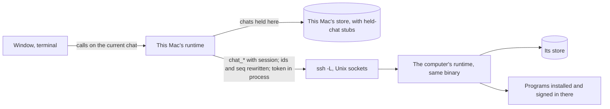

# 0052. A chat runs on the computer the person picks, reached over SSH

Status: Accepted (plan gate passed after two reviews; the owner accepted 2026-10-07)
Date: 2026-10-07
Amends: 0029 (the window switch for a person's own server), 0043 (a location is per chat, not
per project)

## Context
The owner (2026-10-07): "it should be easier to create a session on [my own server]. Not
running the entire ARK, but per session: a chat on my laptop for project X, and another on my
VPS for the same project. When creating a new chat it asks local, or my server. No copies
necessary." Subscriptions (Claude Code, Codex, OpenCode, Cursor) matter most, API keys too, and
the experience stays the same in both places. Owner decisions the same day: bring changed files
back (not a git branch per chat); a prebuilt Linux build per release; the per-chat place
replaces the window-wide This Mac | My machine switch.

| Today | Where | What gets in the way |
|---|---|---|
| A window shows one runtime's page: This Mac, or My machine through `remote::visit` | ADR 0029, Desktop `place.js` | The place is per window. A project's chats cannot run in two places |
| My machine needs Docker, a DNS name, ports 80 and 443 or Tailscale, then `token pair` and a typed address and code | ADR 0043 step 3, Desktop `docs/REMOTE.md` | Four things to copy by hand before the first chat |
| A folder sent to a runtime becomes a new project. `send_folder` sends every file, without modes, links or deletions | ADR 0030, `remote.rs` | One project becomes two rows; nothing comes back; `+x` is lost |
| A link: name, address, token, in the app's process; four fixed calls forwarded; nothing copied into the local store | ADR 0043 step 4, `ark_interact::links` | Only the attention list crosses runtimes |
| The host's chat calls act on its current chat (`send` -> `start_turn` -> `self.cur()`; also `model`, `command`, `context`, `trace`, `workspace`). Approval ids and event `seq` are per host | `ark-ui/src/host.rs` | Forwarding `open_session` then `send` to a server would move the server's own window and race its other clients |
| Subscriptions through the vendor's own CLI (`ark_model::cli`), programs through ACP (`ark-acp`); setup is prose in the catalog | ADR 0012, 0043 step 2 | Each needs the program installed and signed in on the computer that runs the chat |

## Decision
A chat has a **place**: the computer whose runtime holds it and does its work. It is picked
when the chat starts and does not change. **Who answers** (ARK's agent on a model, a
subscription, a program) stays the chat's other choice. The two never depend on each other in
code: a server runs the same runtime as This Mac, so an agent that works on one works on the
other once it is installed and signed in there.

This revisits the option ADR 0029 rejected ("every method needs to know where a project is").
It is now needed per chat, so the protocol gets chat-addressed calls instead of a forwarding
`Host`: only the calls of a chat held elsewhere cross, and they name the chat.

### What the person sees

| Moment | Sees |
|---|---|
| A new chat | Beside the model, a place chip: `This Mac` (`This computer` off macOS). Its menu: This Mac, the person's computers, Add a computer. Fixed after the first message; afterwards a chat held elsewhere has a small mark in the sidebar and the chat header |
| Add a computer | The host names `ssh -G` resolves from `~/.ssh/config` (Include and Match honoured, no wildcards), and a field for `user@host` |
| The first chat on a computer | One progress line in the empty chat while ARK sets it up (Reach). A failure names the step and offers Try again |
| The first chat for a project there | The size of what goes, and a question above 500 MB or 20,000 files. The project stays one row |
| A chat working there | The same chat as on This Mac. Closing the laptop does not stop it. Its questions wait in This Mac's tray (ADR 0043 step 4). A phone gets them only if that computer also has the public address route (ADR 0047); a computer reached only over SSH has no address a phone can reach |
| The computer does not answer | Its held chats stay listed, read only, with "vps is not answering" and Try again. Nothing is typed into them |
| After a turn, when the copy differs from what This Mac has | One line: "3 files changed on vps · Bring to this Mac" |
| A program not ready there | The model menu shows it greyed with one word: Install or Sign in. Each runs that program's own step on that computer |

### Layers

| Layer | Crate | Owns |
|---|---|---|
| Chat-addressed protocol | `ark-ui` host, words in `ark-interact` | `chat_*` calls that name `{session}` and never touch the host's current chat. Used by a runtime that holds chats for another |
| Held chats | `ark-interact` (`links`), `ark-store` | A stub per held chat on This Mac (`HeldChat {runtime_id, session, project, title, updated}`, `serde(default)`), so the list survives a restart and an offline computer. The host routes the person's current chat to its link when it is held |
| Project copy | `ark-ui` (`copy`), a manifest record in `ark-store` | Send, compare, bring back by manifest (below) |
| Reach | new crate `ark-reach` (process orchestration, not presentation) | Hosts via `ssh -G`; setup; a tunnel. The system `ssh` does the connection with the person's config, keys and agent. ARK reads the resolved config to list hosts and never reads keys. The app supplies a `ServeContract` type: how its binary serves on a socket with tokens, creates a token, says its version |
| Programs on a computer | `ark-acp` catalog, `ark_model::cli` | Per program, as data: find, install, sign in, check. Asked of the chat's runtime, never assumed from This Mac |
| The app | ark-desktop | Its Linux builds and their SHA-256 inside the app; Settings › Computers in place of Settings › My machine; the migration of today's My machine |

### Chat-addressed protocol

| Call on the computer | Replaces, for a held chat | Note |
|---|---|---|
| `chat_new {project, model}` | `new_session` | Answers the session id. The computer's own current chat is not changed |
| `chat_send {session, text}`, `chat_cancel {session}`, `chat_steer {session, text}` | `send`, `cancel`, `steer` | The turn runs as a live chat in the background (ADR 0017) |
| `chat_read {session}` | `open_session`'s history and live state | |
| `chat_events {session, after}` | `events` filtered to the chat, plus its approvals | The existing event stream, filtered to the chat; `after` resumes it. Not a poll |
| `chat_approve {session, id, decision}` | `approve` | |
| `chat_model {session, model}`, `chat_context {session}`, `chat_trace {session}` | `model`, `context`, `trace` | |

Not in the set, so refused for a held chat: commands that change the computer's settings,
capabilities and connections, the Terminal panel (it gets its own forwarded stream in step 5,
sign-in only), files of the project outside a chat's events.

On This Mac: when the current chat is held, the host sends the same calls through the link. An
approval id from a computer becomes `<runtime_id>:<id>` before any client sees it, and its
events are numbered again into This Mac's own `seq`. `hello` replays a held chat's live events
from `chat_events`. A computer is known by a store id: new, made once by its runtime, stored, and
returned by `hello`. The terminal (`ark-cli`) works the same way through the same host: `/chats`
lists held chats with their place; opening one sends to its computer.

### Reach: setting up a computer

One SSH connection per setup (`ControlMaster`, `ControlPath` in a 0700 folder under the store,
short enough for the socket limit). Every `ssh` is `ssh [options] -- <host>`; the host and user
are checked against `[A-Za-z0-9._@-]` and a resolved `ssh -G`; every remote argument is quoted.
Host keys follow the person's `known_hosts`. ARK never passes `accept-new` or
`StrictHostKeyChecking=no`.

| Step | Does | Fails with |
|---|---|---|
| 1. Connect | `ssh -o BatchMode=yes -- host true`. An unknown host key, or a key with a passphrase not in the agent, opens the system `ssh` in a terminal sheet once, so the person answers `ssh` itself. A changed host key stops setup | "Could not reach vps: <ssh's last line>" |
| 2. Look | `uname -sm`, glibc version, free disk, an ARK already there and its version, `systemd --user` and linger, an `sshd` that turns socket forwarding off (`AllowStreamLocalForwarding no`, `DisableForwarding yes`) | "vps runs <system>; ARK runs on Linux x86_64 and arm64", or "vps does not allow forwarding (sshd_config)" |
| 3. Install | This Mac downloads the build for that target, checks it against the SHA-256 compiled into the app, and sends it over the SSH connection (the computer may have no `curl` or no way out). Kept under `~/.local/share/<app>/`, with the previous one | "The build did not match; nothing was installed". The release builds the Linux targets first, so their hashes go into the app. A development build takes a local server build from `ARK_SERVER_BUILD` and its hash from the file itself |
| 4. Start | A `systemd --user` service serving on a Unix socket (mode 0600, in a 0700 folder). Linger on (`loginctl enable-linger`); if refused, a terminal sheet runs `sudo loginctl enable-linger <user>` with the person's consent (that stream, with the password, is never stored or traced); if still refused, the chip shows "Stops when you log out of vps" | the service's last log lines |
| 5. Pair | The `ServeContract`'s token command, named after this computer, over the same connection. The token goes to the keychain, never to the screen | |
| 6. Tunnel | `ssh -N -o ExitOnForwardFailure=yes -o StreamLocalBindUnlink=yes -L <local socket>:<remote socket>`, the local socket in a 0700 folder, both paths under 104 bytes. Kept by the app, started again with backoff after sleep or a network change. The link speaks HTTP over that socket (step 1 checks reqwest 0.12's Unix socket support, else a hyper connector), and HTTPS for a computer reached by address | the held chats show "not answering" |

Updates: when the app's version changes, the next reach updates the computer if nothing works
there (no turn, task or schedule running), else after. Remove (Settings › Computers): stops the
service, revokes the token, forgets every key ARK sent there, and asks whether to delete the
store there.

Today's My machine (an HTTPS address and a token in the keychain, `connection.json`) becomes a
Computer reached by address, without SSH. Its chats are held chats like any other.

### Project copy

| Rule | Detail |
|---|---|
| Transport | Over SSH: a `tar` stream through the same connection, which keeps modes and links inside the folder. `upload_parts` stays for Cloud and for a computer reached by address |
| What goes | A git folder: `git ls-files -co --exclude-standard` plus `.git` on the first send only; submodules are not sent in v1. Other folders: everything except the usual build and package folders (`target`, `node_modules`, `.venv`, `__pycache__`, `dist`, `build`), with the size asked above the limit |
| `.git` | Sent once, so the copy has the history and the branch. Never again in either direction: commits on the computer stay there (push them as usual), and files brought back show as changes in This Mac's working tree |
| The manifest | Per copy, on both sides: path, size, mode, SHA-256, written at each send, each bring back and each choice on a file changed on both sides. `.git` is never in it. It is the only record of "what the copy had". A rename of the computer does not break it (keyed by the computer's store id) |
| A later send | Before a chat starts there: files whose This Mac version differs from the manifest. Never one that the computer changed since the manifest (that file is listed in the chat's first line). Deletions are sent too. If a turn or task works in the copy, the send waits until it ends, and the new chat says so |
| Bring back | The computer compares its folder with the manifest: changed, new, deleted, mode changes, whatever made them (a chat, a program, a process, the Terminal). New files follow the send's rules (`git check-ignore` there, or the same folder list), with the size asked above the limit, so build output stays there. This Mac writes them, keeping its own versions before (ADR 0034), so one step undoes it |
| Bring back trusts nothing | The computer sends a `tar` stream; This Mac reads it with ARK's own code, never the system `tar`. It refuses a path outside the project (`ark_files::inside`, no `..`, no absolute path), takes a link only when it points inside the project, never writes through an existing link, and drops setuid and setgid bits |
| Changed on both sides | Per file: Keep this Mac's, or Take vps's. The other side's version is kept as a version before, and the manifest records the choice, so the file is not asked about again |
| Not done | Two-way sync while a chat works; chats, agents and traces moving between computers |

### Who answers, on any computer

| Way in | Signs in | On a computer |
|---|---|---|
| A subscription: Claude Code, Codex (`ark_model::cli`, ADR 0012) | The program's own login, on the computer that runs it. ARK never reads it | Sign in runs the program's login in a terminal sheet attached to the computer: the link to open on the Mac and a code to paste, or a device code. That stream is never stored or traced |
| A program as worker (ADR 0043 step 2), OpenCode and Cursor later | The same | The same |
| An API key | The key the person saved in ARK | Sent to the computer's `FileSecrets` (ADR 0028) once per key, after the person agrees. A key changed on This Mac is offered again on the next reach. Remove forgets them |
| ARK's models (the Account) | A key per computer from the account | Later, with Cloud: the computer signs in itself |
| A local model on This Mac (Ollama) | | Greyed there: "Only on This Mac" |

## Options not chosen

| Option | Why not |
|---|---|
| The agent's loop on This Mac, its tools on the computer over SSH | Work stops when the laptop sleeps. Every tool would need a second backend. Every call pays network time |
| Forward `open_session` and `send` as they are | Moves the computer's own window and races its other clients (plan review) |
| The window switch per runtime (today) | The place belongs to the chat, not the window |
| A transport per runtime in the page, the token in the page | ADR 0043: a token never leaves the app's process. Forwarding in the host also serves the browser and the terminal |
| Docker on the computer | Needs Docker and a published image; one static build is one file (owner) |
| A git branch per chat | Code projects only (owner chose files) |
| Changes from ARK's records (versions before, a worker's folder diff) | They miss `process.start`, the Terminal, delegated tasks and hidden folders (plan review). The manifest misses nothing in the folder |
| Carrying a subscription's token from This Mac (`claude setup-token`) | ARK would read a vendor credential (ADR 0012) |
| A TCP port on 127.0.0.1 for the tunnel | Other users on a shared computer reach it. Unix sockets with 0600 do not |
| `remote::visit` for these computers | Its URL carries the token |

## Consequences
- ADR 0029's switch goes for the person's own computers; `visit` stays for Cloud. Desktop's
  Settings › My machine becomes Settings › Computers.
- ADR 0043's "a project's location" becomes a chat's place. A project can have chats in
  several places.
- A computer reached only over SSH sends no phone notifications. The public route (Caddy, `token
  pair`) stays for people who want them.
- The headless build has to run on stock servers: rustls instead of native-tls, `FileSecrets`
  instead of the kernel keyring, glibc no newer than Ubuntu 20.04's or musl (step 0).
- Run code is off on these computers in v1 (`uv` and bubblewrap; Ubuntu 24.04 blocks user
  namespaces). The chat says so once.
- Not in v1: Windows as This Mac (no `ControlMaster`, Unix sockets differ), OpenCode and Cursor
  (step 7), ARK's models on a computer.

## Order of work
Each step ends with its check. Container tests run only with `ARK_TEST_SSH=1` (they need Docker).

| # | Step | Repo | Done means |
|---|---|---|---|
| 0 | A headless build that runs on stock servers | ark-desktop, ARK deps | The `--serve` build starts, serves on a Unix socket, stores keys in `FileSecrets` on Ubuntu 20.04, 22.04, 24.04 and Debian 12, x86_64 and arm64 (containers) |
| 1 | Chat-addressed calls and held chats | ARK | Two runtimes, A linked to B. A chat placed on B: stub on A, a turn streams on A, stop, steer, a question answered on A. B's own window and a second client of B stay on their chats while A sends. A's and B's approval ids collide and are still told apart. B's token in no answer, event or log of A. B down: A lists the chat read only; A restarted: still listed. The terminal opens it too |
| 2 | Project copy | ARK | First send keeps modes and skips ignored files; a size question above the limit; a later send carries only changes and deletions; a computer change is never replaced; a send waits for work in the copy; Bring back finds a file written by a process and one in a hidden folder; a `cargo build` there brings back nothing from `target/`; a link to `~/.ssh` made there is refused; both sides changed: Keep or Take, the other kept as a version before, and the next send goes on; `.git` sent once |
| 3 | Reach over SSH | ARK (`ark-reach`) | Against `sshd` in a container: hosts from `ssh -G` with Include; `-oProxyCommand=` and quotes in names refused; a changed host key stops setup; setup from nothing; again does nothing; a build with the wrong hash refused; linger refused shows the mark; the tunnel closed mid-turn and the turn finishes on the computer; the tunnel back after `sshd` restarts; Remove revokes the token and forgets keys |
| 4 | The place chip and Add a computer | ARK shell | Page tests: an empty chat offers places; fixed after the first message; the mark; setup progress and its failure; an offline computer's chats read only; light and dark, 1280 and 390 wide |
| 5 | Programs on a computer | ARK | A spike per program first: Claude Code and Codex install and sign in on a server with no screen (Codex device auth). Then: the model menu asks the chat's runtime; install and sign in run there; the sign-in stream is not stored or traced; a key sent after the person agrees; a local model greyed |
| 6 | ARK Desktop | ark-desktop | Settings › Computers; today's My machine migrated; the native dogfood on a real VPS: a Claude Code subscription chat on the VPS and one on This Mac in the same project, the laptop closed, the work done, files brought back |
| 7 | OpenCode and Cursor | ARK (`ark-acp`) | Catalog entries, ADR 0043's step 0 checks per program |
| 8 | Second consumer | ARK (`examples/writing-agent`) | The writer places a chat on a computer with its own `ServeContract`; a chapter changed there comes back |

## Results (2026-10-07)

Built on branch `places` (ARK) and `places` (ARK Desktop), not committed yet.

| Step | Built | Evidence |
|---|---|---|
| 0 | rustls only (no OpenSSL on Linux); `ArkUi::serve("unix:…")` 0600 in a 0700 folder; `remote::Client` on `unix:`; Desktop `scripts/linux-builds.sh` (Debian 11, glibc 2.29 at most) and `linux-check.sh` | `tests/socket.rs` (4); 8 of 8: Ubuntu 20.04, 22.04, 24.04, Debian 12 on x86_64 and arm64 |
| 1 | `chat_*` calls (`host.rs`), held chats (`ark_interact::held`, `host/held.rs`), a relay per place, ids `<runtime id>:<id>`, `Effect::Open` for `/resume`, `/chats` | `tests/places.rs`: placed and streamed, B's window stays, ids told apart, steer and stop, away and after a restart, the terminal |
| 2 | `ark_ui::copy` (manifest, select, changes, plan, pack, apply), `host/copying.rs` (`copy_*` there; `place_changes`, `place_bring` here), `Engine::keep_before` | `tests/copy.rs` (14); `places.rs` the project goes with the chat and its changes come back |
| 3 | crate `ark-reach` | 22 unit tests; `ARK_TEST_SSH=1` against `sshd` and a `systemd --user` container |
| 4 | the place chip, the line above the composer (Bring back, a choice per file, not answering), marks in the sidebar and header, Settings › Computers (`computers.js`; SSH hosts, `user@host`, or an address and a code) | page tests `places`, `places_away` with pictures (light, dark, 390 wide) |
| 5 | the model menu asks the chat's computer; Install and Sign in run the program's own step there in a terminal sheet (`chat_setup`); a key sent when asked, forgotten on Remove only while it is still the key sent (by its SHA-256; not proven by a test: saving a key there checks it with the provider over the network) | spike in Ubuntu 24.04: Claude Code installs without Node (`claude.ai/install.sh`), signs in with a pasted code; Codex with `--device-auth`; `places.rs` a program signs in on the server from here |
| 6 | Desktop: `src/computers.rs` (its contract, builds by architecture, `ARK_SERVER_BUILD`), Settings › My machine and the window switch gone, a paired My machine moved to Computers once | `tests/computers.rs` with `ARK_TEST_SSH=1` and Desktop's arm64 build: setup, a chat there asks here, `sshd` restarts with the question open, the file comes back, Remove revokes the token |
| 7 | not done | OpenCode 1.4.0 speaks ACP itself (`opencode acp`), takes its config in `OPENCODE_CONFIG_CONTENT`, lists models in `session/new`; its free models refuse clients other than its own app, so the asks-before-writing check needs a signed-in provider. Cursor is not installed here |
| 8 | the writer: `--version`, `--revoke-token`, its own contract, Computers with `WRITER_SERVER_BUILD`; ARK `scripts/linux-build.sh` | `tests/computers.rs` with `ARK_SERVER_KIND=writer`: a chapter saved there with the writer's own tool comes back |

Where it differs from the plan:

| Plan | Built | Why |
|---|---|---|
| A send waits while work runs in the copy | The chat starts without the send and says so; the next chat sends | A wait with no end in sight is worse than a chat on the copy as it is |
| A local model greyed "Only on This Mac" | The menu lists the computer's own: its Ollama when it runs one | The computer answers for itself |
| "Bring back" undone in one step | Each file brought back keeps its version before (ADR 0034); no single Undo yet | A new file has no version to put back; one Undo needs a list of deletions too |
| The copy over a `tar` stream through SSH | Through the link (HTTP over the tunnel's socket), in parts | The same calls serve a computer reached by its address |
| `chat_events {session, after}` on the computer | The computer's whole event stream, followed once per place here and filtered to its held chats; only a chat's kinds of event, with their known fields, pass on. After a gap, `chat_read` reads each held chat again | One stream per place, not per chat; the filter is where the trust is |
| The terminal opens a held chat | A terminal connected to this runtime (it goes through the host) opens it with `/resume`, and `/new`, `/chats`, `/resume` work while one is shown. The terminal on its own (`ark-cli` in process) lists held chats and says where one runs | The in-process terminal has no host to pass the calls through |
| A computer that does not answer | Remove there, or Remove here only: what was there stays there, and the window says so | A computer deleted at its provider could not be removed |
| A chat's model is its own | Kept here and sent with every call; a chat the computer's own window shows at that moment is one shared chat, with the model chosen there until the next message from here | One chat, not two copies |
| Remove revokes the token | Over SSH, yes. A computer reached by its address keeps this computer's sign-in until it is signed out under Settings › Devices there; the confirmation says so | Its session is the computer's to end; this one only forgets it |

## Check
Written with each step. `crates/ark-ui/tests/neutral.rs` keeps `ark-reach` free of any vendor
or product name; the place, the link and the copy were checked by hand (2026-10-07).

Implementation gate (qa, 2026-10-07): no-go on one blocker (the folder of `ssh`'s and the
tunnel's sockets in `/tmp` was not checked for its owner) and five majors (any event kind from a
computer reached the window; held conversations were never dropped; a computer that does not
answer could not be removed; Remove left keys and a follower behind; commands refused while a
held chat is shown). Fixed, with tests for the criteria it found untested: the token in no file
of this computer, the sign-in in no file of either, a send while work runs in the copy, the
computer's own terminals and stream ids refused, a file through a linked folder not packed.
The second review found two more majors, fixed with tests: a held chat showed the computer's own
model after a turn (every call now carries the chat's model; a chat read there is let go after),
and a removed computer's chat stayed on screen with its questions in the tray.
